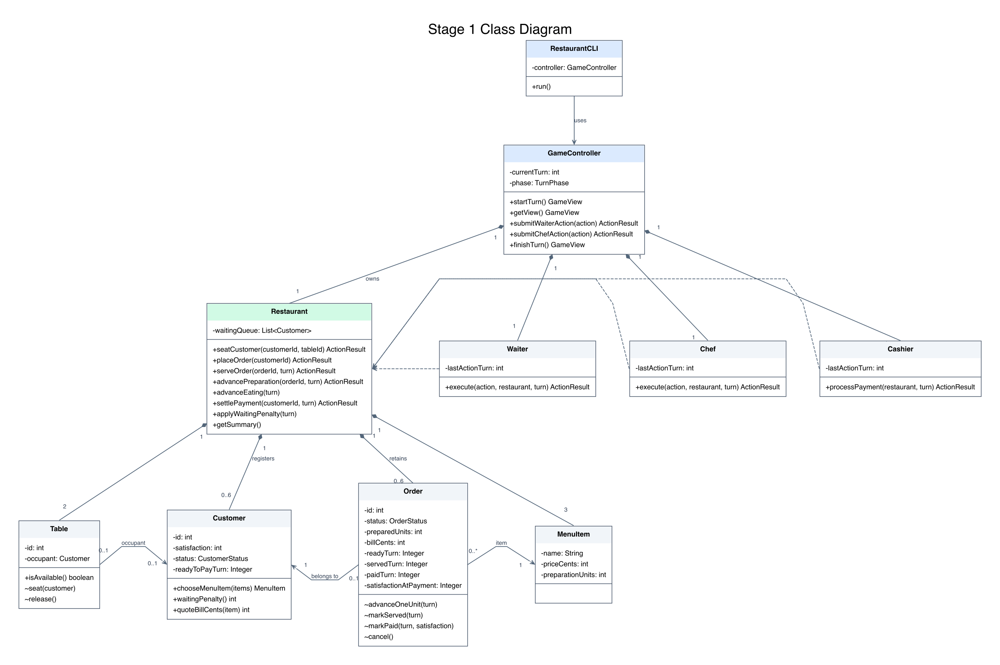

# Stage 1 Design Materials

English design proposal for team discussion before implementation.

- [PDF design document](Stage_1_Design_Discussion_EN.pdf) - includes class responsibilities, relationships, interface contracts, states, turn rules, acceptance scenarios, and the UML diagram.
- [Editable English text](Stage_1_Design_Discussion_EN.md).
- [UML files and editing instructions](UML/README.md).

The architecture and method contracts are proposed team decisions. Acceptance scenarios are manually derived specifications pending implementation and execution.

