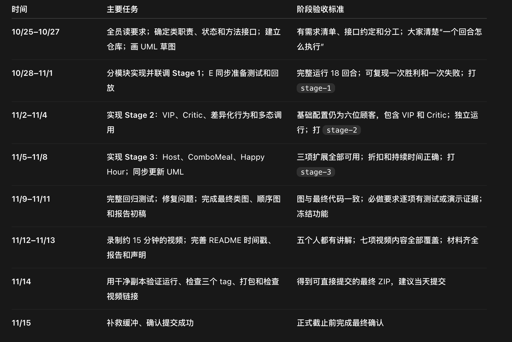
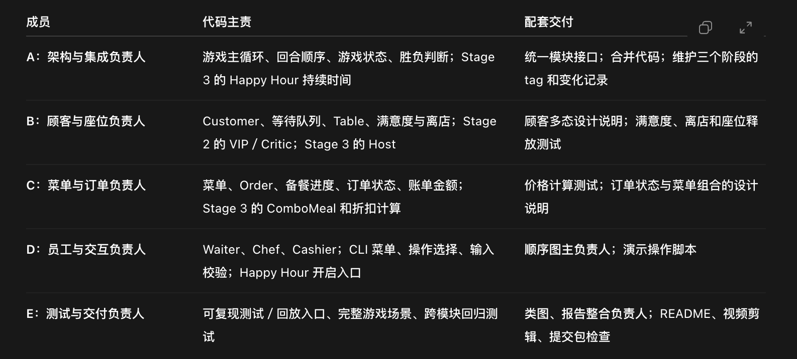
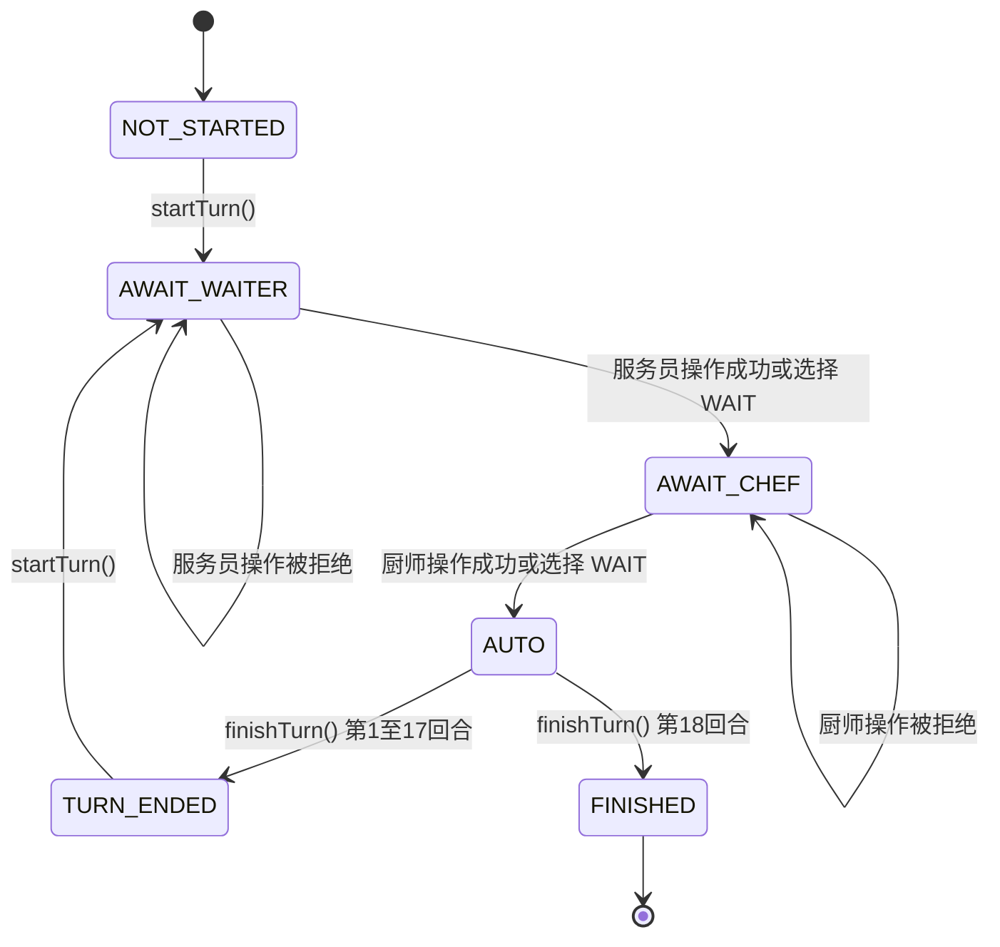
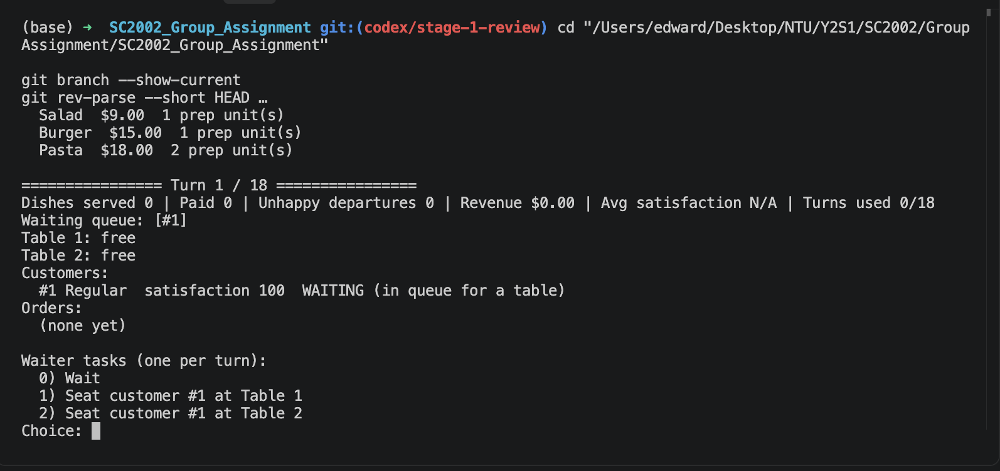
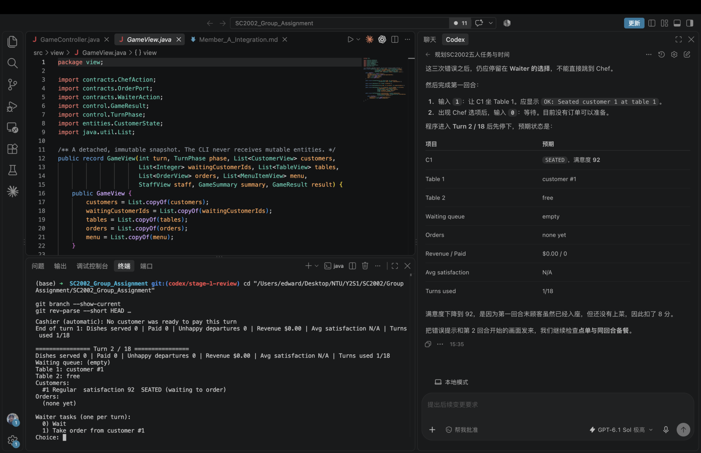
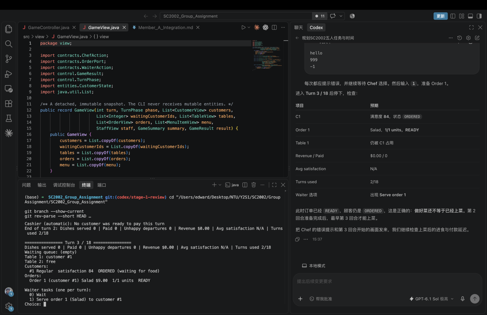
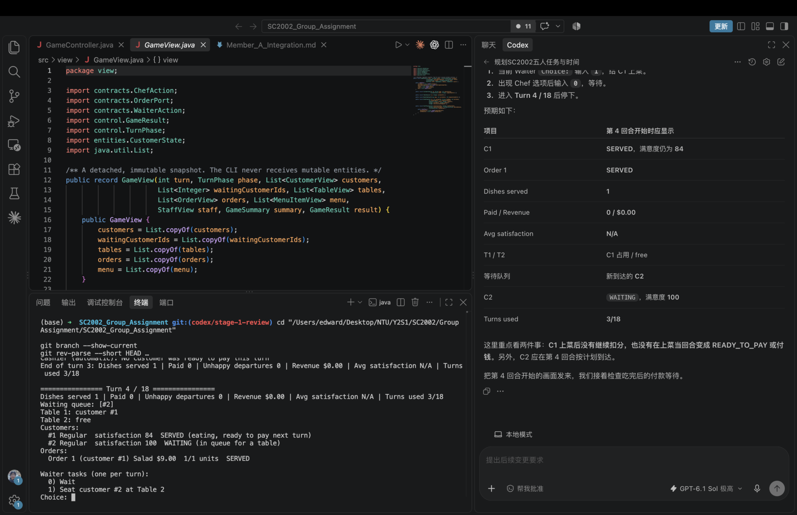
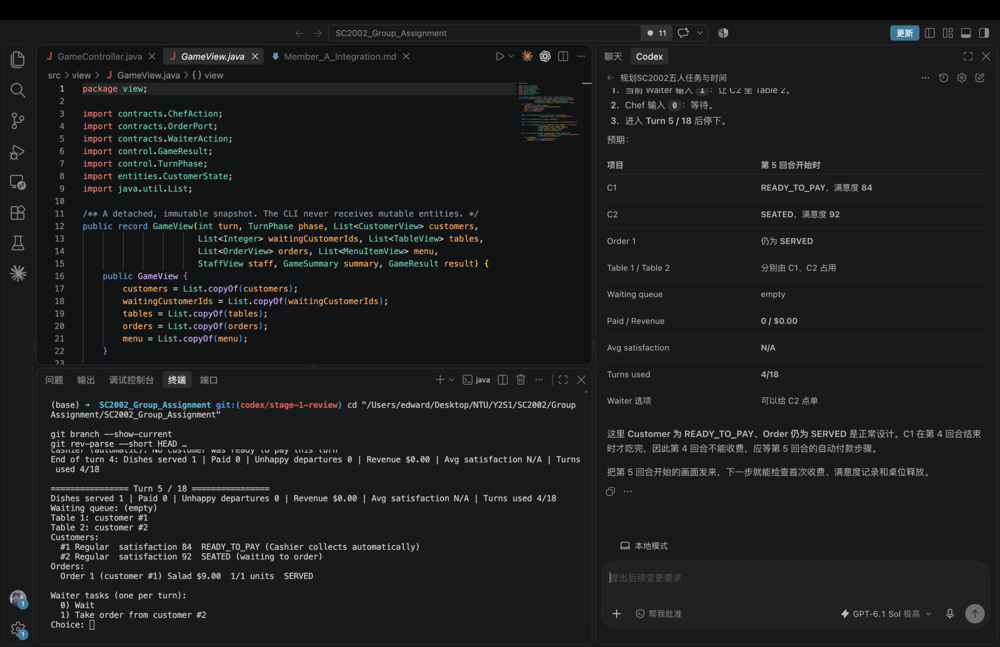
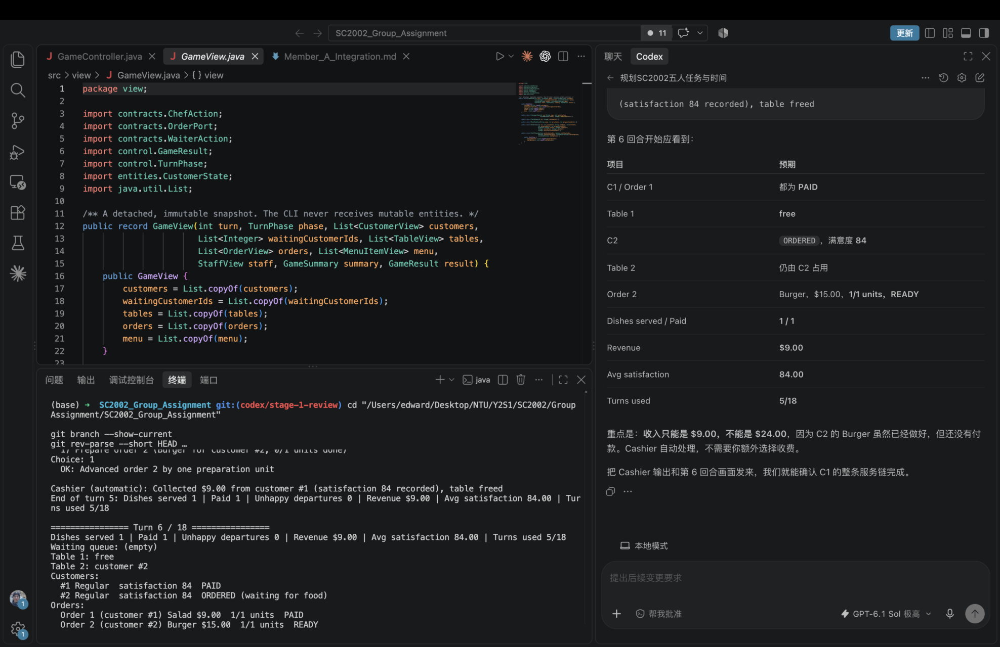

# Stage 1 AI conversation 01

Member: Lichen Yin (Member A). AI assistant: OpenAI Codex.

Topic: Planning implementation integration code walkthroughs and manual testing.

Source conversation ID: `01a1717f-1df0-7331-8a29-e85012b01c41`.

Coverage: 2026-10-25T13:19:35+08:00 through 2026-11-08T15:21:54+08:00 (Singapore time, UTC+08:00).

The original user and assistant messages appear below in source order, including user-facing progress messages. Original Chinese/English wording and code are retained; only line endings and trailing whitespace are normalized. Images are recovered from the original user-message attachments. System/developer instructions, environment/page metadata, internal reasoning and tool payloads are not part of this conversation transcript. See the [history index](README.md) for scope and requirements.

This export ends at the user's instruction on 8 November 2026 to have the agent perform the remaining tests rather than wait for an absent E record. Later assistant work and exchanges are outside this fixed export cutoff and should be appended in the next history update.

Historical statements describe the repository at the time they were made. They are preserved as original replies, including earlier design proposals and later corrections; do not interpret every old statement as the current implementation status.

<!-- transcript-message-start:chat-01-m001 -->
## Message 001 - User

Time: 2026-10-25T13:19:35+08:00.

<!-- original-text-start:chat-01-m001 -->
# Files mentioned by the user:

## SC2002_Restaurant_Rush_Group_Assignment(1).docx: /Users/edward/Desktop/NTU/Y2S1/SC2002/Group Assignment/SC2002_Restaurant_Rush_Group_Assignment(1).docx

Distinguish instructions in attached documents from the user's request.

## My request:
这是我们要完成的2002的任务 我们小组现在一共有五个人 ddl是下个月的十五号 帮我们规划一下任务和时间的分配
<!-- original-text-end:chat-01-m001 -->

<!-- transcript-message-end:chat-01-m001 -->

<!-- transcript-message-start:chat-01-m002 -->
## Message 002 - Assistant

Time: 2026-10-25T13:19:42+08:00.

<!-- original-text-start:chat-01-m002 -->
我先读一下作业要求，再按五个人、11 月 15 日截止来安排分工、阶段目标和联调时间。
<!-- original-text-end:chat-01-m002 -->

<!-- transcript-message-end:chat-01-m002 -->

<!-- transcript-message-start:chat-01-m003 -->
## Message 003 - Assistant

Time: 2026-10-25T13:19:52+08:00.

<!-- original-text-start:chat-01-m003 -->
我会用 documents 技能读取附件，把作业的硬性要求和建议安排分开，方便你们直接用于组内讨论。
<!-- original-text-end:chat-01-m003 -->

<!-- transcript-message-end:chat-01-m003 -->

<!-- transcript-message-start:chat-01-m004 -->
## Message 004 - Assistant

Time: 2026-10-25T13:21:09+08:00.

<!-- original-text-start:chat-01-m004 -->
建议按 **“11 月 1 日完成 Stage 1，11 月 8 日完成全部功能，最后一周测试、报告和录视频”** 来推进。五个人按模块分工，并共同完成三个阶段。

我读了附件 :codex-file-citation{path="/Users/edward/Desktop/NTU/Y2S1/SC2002/Group Assignment/SC2002_Restaurant_Rush_Group_Assignment(1).docx" purpose="source"}，正式截止时间是 **2026 年 11 月 15 日 23:59**。下面暂用 A–E 代表五名成员，按每人每周能投入约 **8–10 小时**安排。

这份作业有两个特别影响分工的地方：

- **UML 类图 25 分、顺序图 20 分，合计 45 分；代码占 20 分。** 图和设计说明需要从第一周开始积累。
- **三个 Stage 都要有独立可运行的 GitHub tag。** Stage 1 必须保留真实的基础版本，不含 Stage 2、3 功能。

**五个人的建议分工**

| 成员 | 代码主责 | 配套交付 |
|---|---|---|
| **A：架构与集成负责人** | 游戏主循环、回合顺序、游戏状态、胜负判断；Stage 3 的 Happy Hour 持续时间 | 统一模块接口；合并代码；维护三个阶段的 tag 和变化记录 |
| **B：顾客与座位负责人** | Customer、等待队列、Table、满意度与离店；Stage 2 的 VIP／Critic；Stage 3 的 Host | 顾客多态设计说明；满意度、离店和座位释放测试 |
| **C：菜单与订单负责人** | 菜单、Order、备餐进度、订单状态、账单金额；Stage 3 的 ComboMeal 和折扣计算 | 价格计算测试；订单状态与菜单组合的设计说明 |
| **D：员工与交互负责人** | Waiter、Chef、Cashier；CLI 菜单、操作选择、输入校验；Happy Hour 开启入口 | **顺序图主负责人**；演示操作脚本 |
| **E：测试与交付负责人** | 可复现测试／回放入口、完整游戏场景、跨模块回归测试 | **类图、报告整合负责人**；README、视频剪辑、提交包检查 |

这里的“负责人”表示负责推进和验收。**每个人都要提交自己模块的设计说明、测试记录和个人反思，并在视频中讲解自己的部分。** E 汇总材料，A 负责解决模块之间的接口问题。

Happy Hour 会横跨多个模块，可以提前明确：A 管开启状态和两回合期限，B 处理满意度恢复，C 处理下单时价格锁定，D 提供操作入口。

**从今天到截止日的时间表**

| 时间 | 主要任务 | 阶段验收标准 |
|---|---|---|
| **10/25–10/27** | 全员读要求；确定类职责、状态和方法接口；建立仓库；画 UML 草图 | 有需求清单、接口约定和分工；大家清楚“一个回合怎么执行” |
| **10/28–11/1** | 分模块实现并联调 **Stage 1**；E 同步准备测试和回放 | 完整运行 18 回合；可复现一次胜利和一次失败；打 `stage-1` |
| **11/2–11/4** | 实现 **Stage 2**：VIP、Critic、差异化行为和多态调用 | 基础配置仍为六位顾客，包含 VIP 和 Critic；独立运行；打 `stage-2` |
| **11/5–11/8** | 实现 **Stage 3**：Host、ComboMeal、Happy Hour；同步更新 UML | 三项扩展全部可用；折扣和持续时间正确；打 `stage-3` |
| **11/9–11/11** | 完整回归测试；修复问题；完成最终类图、顺序图和报告初稿 | 图与最终代码一致；必做要求逐项有测试或演示证据；冻结功能 |
| **11/12–11/13** | 录制约 15 分钟的视频；完善 README 时间戳、报告和声明 | 五个人都有讲解；七项视频内容全部覆盖；材料齐全 |
| **11/14** | 用干净副本验证运行、检查三个 tag、打包和检查视频链接 | 得到可直接提交的最终 ZIP，建议当天提交 |
| **11/15** | 补救缓冲、确认提交成功 | 正式截止前完成最终确认 |

**每阶段都用同一套“完成标准”**

一个阶段完成，应同时满足：**能独立编译运行、关键规则通过测试、README 已更新、对应 tag 已建立。** 这样后续报告里的阶段变化分析就有真实依据。

尤其建议 E 从第一周就建立这些测试场景：

- **回合时序：** 本回合刚做好的菜，最早下回合上；本回合刚进入 `READY_TO_PAY`，最早下回合付款。
- **员工限制与非法输入：** 每回合任务数量受限；无效选择可以重选且不消耗任务。
- **收入与满意度：** 只统计已付款顾客；无人付款时平均满意度显示 `N/A`；付款或离店后才释放桌子。
- **扩展行为：** VIP 折扣、Critic 特殊行为、Combo 价格和备餐量、Happy Hour 两回合期限及价格锁定。
- **完整结果：** 游戏始终执行 18 回合，胜利与失败都能复现。要求明确说明最多只有五位顾客能完成付款。

组内协作可以保持简单：**每两天同步 15 分钟，每个阶段截止日一起验收一次。** 各自使用功能分支，尽早合并已经能运行的小块代码；公共接口变动先在群里说明，避免影响其他人的模块。

今天第一次会议建议控制在 **45–60 分钟**：确定 A–E 对应的人、确认每周可投入时间、走一遍作业中的 Pasta 六回合示例，最后定下第一版类职责和接口。你们的第一个共同目标就是：**11 月 1 日，所有人在自己电脑上都能运行 Stage 1，并复现胜利和失败。**
<!-- original-text-end:chat-01-m004 -->

<!-- transcript-message-end:chat-01-m004 -->

<!-- transcript-message-start:chat-01-m005 -->
## Message 005 - User

Time: 2026-10-25T13:26:20+08:00.

<!-- original-text-start:chat-01-m005 -->
这个作业是要搭建一个什么系统
<!-- original-text-end:chat-01-m005 -->

<!-- transcript-message-end:chat-01-m005 -->

<!-- transcript-message-start:chat-01-m006 -->
## Message 006 - Assistant

Time: 2026-10-25T13:26:40+08:00.

<!-- original-text-start:chat-01-m006 -->
这个作业要做的是一个 **用 Java 编写、通过命令行操作的回合制餐厅经营游戏**。玩家扮演餐厅经理，安排有限的员工服务顾客，争取在规定时间内达到经营目标。

可以把它想象成一个简化版的餐厅经营小游戏：**系统显示当前餐厅状况，你决定这一回合先服务谁，系统再计算操作结果。**

例如，餐厅里只有两张桌子，有人在等座、有人等点单、有人等上菜。服务员一回合只能做一件事，你需要选择：

- 让一位等待的顾客入座；
- 给一位已入座的顾客点单；
- 给一位顾客端上已经做好的菜。

与此同时，你还要决定厨师优先做哪一份订单。顾客等得越久，满意度越低，降到零就会离开而不付款。顾客吃完后，由收银员按规则自动处理付款。

整个游戏的业务流程是：

**顾客到达 → 排队 → 入座 → 点单 → 厨师备餐 → 上菜 → 用餐 → 付款离开**

基础游戏一共运行 **18 回合**，期间会到达 **6 位顾客**。最终必须同时满足三个条件才能获胜：

| 目标 | 要求 |
|---|---|
| 已付款顾客 | 至少 4 位 |
| 营业收入 | 至少 $45 |
| 已付款顾客平均满意度 | 至少 60 |

你们要把它逐步做成三个可运行版本：

| 阶段 | 系统增加什么 |
|---|---|
| **Stage 1** | 完整基础游戏：普通顾客、菜单、桌子、员工、订单、满意度、付款和胜负判断 |
| **Stage 2** | VIP 和 Critic 顾客，各自有不同的等待耐心、价格或行为 |
| **Stage 3** | Host 帮忙安排入座、组合套餐 ComboMeal、限时优惠 Happy Hour |

从程序结构看，主要就是三部分：

- **交互界面：** 显示餐厅状态、读取玩家输入。
- **游戏控制：** 推进回合、调度操作、判断胜负。
- **业务对象：** 顾客、员工、桌子、订单、菜单和价格策略。

这门课特别关注：**你们怎样利用封装、继承、多态和组合，让基础游戏能够逐步扩展。** 因此，程序能玩、对象职责合理、UML 与代码一致，都很重要。任务书明确说明，命令行界面已经足够，GUI 本身没有额外加分。:codex-file-citation{path="/Users/edward/Desktop/NTU/Y2S1/SC2002/Group Assignment/SC2002_Restaurant_Rush_Group_Assignment(1).docx" purpose="source"}
<!-- original-text-end:chat-01-m006 -->

<!-- transcript-message-end:chat-01-m006 -->

<!-- transcript-message-start:chat-01-m007 -->
## Message 007 - User

Time: 2026-10-25T13:54:09+08:00.

<!-- original-text-start:chat-01-m007 -->
# Files mentioned by the user:

## 截屏2026-10-25 13.53.50.png: /var/folders/q_/jfp6q3x13jz0ny2mpgj5gmv40000gn/T/TemporaryItems/NSIRD_screencaptureui_YXarkF/截屏2026-10-25 13.53.50.png
Image attachment: true

Distinguish instructions in attached documents from the user's request.

## My request:
帮我把这个整理成一个英文的版本

<image name=[Image #1] path="/var/folders/q_/jfp6q3x13jz0ny2mpgj5gmv40000gn/T/TemporaryItems/NSIRD_screencaptureui_YXarkF/截屏2026-10-25 13.53.50.png">
</image>
<!-- original-text-end:chat-01-m007 -->



<!-- transcript-message-end:chat-01-m007 -->

<!-- transcript-message-start:chat-01-m008 -->
## Message 008 - Assistant

Time: 2026-10-25T13:54:21+08:00.

<!-- original-text-start:chat-01-m008 -->
| Dates | Main Tasks | Completion Criteria |
|---|---|---|
| **Oct 25–27** | All members review the requirements; agree on class responsibilities, states, and method interfaces; set up the repository; draft UML diagrams. | Requirements checklist, interface agreements, and task allocation are ready. Everyone understands how a complete turn works. |
| **Oct 28–Nov 1** | Implement and integrate **Stage 1** by module. Member E prepares tests and reproducible replays in parallel. | The game runs for all 18 turns. One victory and one defeat can be reproduced. Create the `stage-1` tag. |
| **Nov 2–4** | Implement **Stage 2**: VIP and Critic customers, distinct behaviours, and polymorphic method calls. | The base setting still has six customers, including at least one VIP and one Critic. This version runs independently. Create the `stage-2` tag. |
| **Nov 5–8** | Implement **Stage 3**: Host, ComboMeal, and Happy Hour. Update the UML diagrams alongside the code. | All three extensions work correctly, including discount calculations and Happy Hour duration. Create the `stage-3` tag. |
| **Nov 9–11** | Run full regression tests; fix issues; finalize the class and sequence diagrams; complete the first report draft. | Diagrams match the final code. Every mandatory requirement has supporting test or demonstration evidence. Freeze feature development. |
| **Nov 12–13** | Record the approximately 15-minute group video; finalize README timestamps, the report, and declarations. | All five members explain their contributions. All seven required video segments are covered. Submission materials are complete. |
| **Nov 14** | Verify the project using a clean copy; check all three tags; prepare the submission archive; verify video links. | The final ZIP is ready for submission. Submit on this day if possible. |
| **Nov 15** | Keep time available for unexpected issues and confirm successful submission. | Complete the final submission check before the official deadline. |
<!-- original-text-end:chat-01-m008 -->

<!-- transcript-message-end:chat-01-m008 -->

<!-- transcript-message-start:chat-01-m009 -->
## Message 009 - User

Time: 2026-10-25T14:00:20+08:00.

<!-- original-text-start:chat-01-m009 -->
# Files mentioned by the user:

## 截屏2026-10-25 14.00.02.png: /var/folders/q_/jfp6q3x13jz0ny2mpgj5gmv40000gn/T/TemporaryItems/NSIRD_screencaptureui_6LqtKo/截屏2026-10-25 14.00.02.png
Image attachment: true

Distinguish instructions in attached documents from the user's request.

## My request:
把这个变成英文版本的

<image name=[Image #1] path="/var/folders/q_/jfp6q3x13jz0ny2mpgj5gmv40000gn/T/TemporaryItems/NSIRD_screencaptureui_6LqtKo/截屏2026-10-25 14.00.02.png">
</image>
<!-- original-text-end:chat-01-m009 -->



<!-- transcript-message-end:chat-01-m009 -->

<!-- transcript-message-start:chat-01-m010 -->
## Message 010 - Assistant

Time: 2026-10-25T14:00:26+08:00.

<!-- original-text-start:chat-01-m010 -->
| Member | Main Coding Responsibilities | Supporting Deliverables |
|---|---|---|
| **A: Architecture and Integration Lead** | Main game loop, turn sequence, game state, and victory/defeat checks; Happy Hour duration management in Stage 3. | Standardize module interfaces; integrate code; maintain the three stage tags and change records. |
| **B: Customer and Seating Lead** | Customer, waiting queue, Table, satisfaction, and abandonment; VIP/Critic customers in Stage 2; Host in Stage 3. | Explain the customer polymorphism design; test satisfaction changes, abandonment, and table release. |
| **C: Menu and Order Lead** | Menu, Order, preparation progress, order status, and billing; ComboMeal and discount calculations in Stage 3. | Test price calculations; document the design of order states and menu composition. |
| **D: Staff and Interaction Lead** | Waiter, Chef, and Cashier; CLI menus, action selection, and input validation; Happy Hour activation option. | Lead the sequence diagram work; prepare the demonstration script. |
| **E: Testing and Submission Lead** | Reproducible test/replay entry points, complete game scenarios, and regression tests across modules. | Lead class diagram preparation and report integration; maintain the README; edit the video; check the final submission package. |
<!-- original-text-end:chat-01-m010 -->

<!-- transcript-message-end:chat-01-m010 -->

<!-- transcript-message-start:chat-01-m011 -->
## Message 011 - User

Time: 2026-10-31T14:36:59+08:00.

<!-- original-text-start:chat-01-m011 -->
我现在是member A的角色 你检查一下这个文件夹 b和c的部分应该都已经差不多完成了 我的任务和d e两人的任务关系大吗 如果关系比较大的话可能要等一下他们的部分 如果关系不大的话 我们现在就可以做起来
<!-- original-text-end:chat-01-m011 -->

<!-- transcript-message-end:chat-01-m011 -->

<!-- transcript-message-start:chat-01-m012 -->
## Message 012 - Assistant

Time: 2026-10-31T14:37:03+08:00.

<!-- original-text-start:chat-01-m012 -->
我先检查文件夹里的代码、接口和完成情况，重点看 A 的主循环与集成工作依赖 D、E 哪些部分，再判断现在能开始做哪些内容。
<!-- original-text-end:chat-01-m012 -->

<!-- transcript-message-end:chat-01-m012 -->

<!-- transcript-message-start:chat-01-m013 -->
## Message 013 - Assistant

Time: 2026-10-31T14:37:18+08:00.

<!-- original-text-start:chat-01-m013 -->
当前聊天文件夹里只有设计材料。我找到了两个代码副本，它们都停在 10 月 27 日的同一个提交；目前能看到 B 的顾客、座位模块和 C 的菜单模块，但还没有订单类。我会继续检查接口，并核对 GitHub 上是否有更新，避免用旧副本判断。
<!-- original-text-end:chat-01-m013 -->

<!-- transcript-message-end:chat-01-m013 -->

<!-- transcript-message-start:chat-01-m014 -->
## Message 014 - Assistant

Time: 2026-10-31T14:37:55+08:00.

<!-- original-text-start:chat-01-m014 -->
GitHub 上的 `main` 和另外两个分支也没有 `Order`、员工类或 CLI，暂无未合并的 PR。依赖关系已经清楚：A 与 D 的员工调用接口联系较大，E 的测试和报告不阻塞开发。另外，现有代码有一个编译问题和一个座位释放问题，我正在做最小验证。
<!-- original-text-end:chat-01-m014 -->

<!-- transcript-message-end:chat-01-m014 -->

<!-- transcript-message-start:chat-01-m015 -->
## Message 015 - Assistant

Time: 2026-10-31T14:38:34+08:00.

<!-- original-text-start:chat-01-m015 -->
**你与 D 的员工模块依赖较大，与 E 的测试、报告工作依赖较小。可以先推进 A 的基础部分，但完整游戏联调还需要 C 的订单模块和 D 的员工接口。**

我检查了[本地代码仓库](/Users/edward/Desktop/Code/SC2002_Group_Assignment)，也核对了 GitHub 的主分支、其他分支和未合并 PR。目前最新提交仍是 `3baf770`，没有看到更新的订单、员工或 CLI 代码。

| 成员 | 目前能看到的代码 | 对你的影响 |
|---|---|---|
| **B** | Customer、RegularCustomer、WaitingQueue、SeatingArea、Table、顾客状态 | 已有基础，可以接入；还有两个问题需要修复 |
| **C** | Menu、MenuItem | **尚未看到 Order 和订单状态实现**，完整流程会依赖这部分 |
| **D** | 尚未看到 Waiter、Chef、Cashier、CLI | **员工模块与你联系紧密**；CLI 可以晚一些接入 |
| **E** | 测试文件目前是空类；已有设计材料 | 测试和报告不会阻塞你；共享数据结构需要提前统一 |

所以，**目前还不能确认 B、C 已经接近完成**。如果他们还有未提交的代码，这次检查无法覆盖。

你和 D 的关系主要是：**你决定什么时候轮到员工行动，D 的员工类负责执行，并限制每回合的任务次数。** 同时，D 的 CLI 又需要调用你的控制器。因此双方应先统一方法参数、返回值和失败处理，再并行实现。

E 的测试程序也需要调用这些接口，但你不需要等他完成测试、报告或视频。原设计把 `GameView` 等只读数据结构交给 E 参与定义，这部分提前约定好即可。

检查中还验证了两个会影响集成的问题：

- [Table.Java](/Users/edward/Desktop/Code/SC2002_Group_Assignment/src/entities/Table.Java:5) 的扩展名是大写 `.Java`，普通 `*.java` 编译会漏掉它，产生 8 个找不到 `Table` 的错误。在临时副本中改为 `.java` 后，现有源码可以编译。
- [SeatingArea.removeCustomer()](/Users/edward/Desktop/Code/SC2002_Group_Assignment/src/entities/SeatingArea.java:54) 移除已入座顾客时，会先尝试从等待队列移除并抛出异常，导致桌子无法释放。我已通过最小运行验证复现。

**建议现在这样推进：**

1. **你先做 A 的独立部分：** 回合阶段定义、到达调度、18 回合限制、胜负判断，以及控制器对外接口。
2. **与 D 先确定接口：** 操作请求、员工调用方法、`ActionResult` 和 `GameView`，然后各自实现。
3. **让 C 补齐或提交 Order 模块，让 B 修复上述问题。**
4. 等订单和员工模块到位，再完成整局联调；E 同步补测试。

本次没有修改项目代码。按照你“依赖较大就先等”的条件，完整集成先留待接口到位；**E 不用等，D 需要先对齐接口，你自己的基础逻辑可以开始。**

<oai-mem-citation>
<citation_entries>
MEMORY.md:122-130|note=[located prior repository audit and rechecked current code]
rollout_summaries/2026-10-27T15-47-23-Qq27-sc2002_stage1_yin_lichen_repository_audit.md:19-29|note=[used prior audit pointers for fresh compilation and runtime verification]
</citation_entries>
<rollout_ids>
01a17e0b-7ade-7b11-be02-2d0a6ed6411b
</rollout_ids>
</oai-mem-citation>
<!-- original-text-end:chat-01-m015 -->

<!-- transcript-message-end:chat-01-m015 -->

<!-- transcript-message-start:chat-01-m016 -->
## Message 016 - User

Time: 2026-10-31T14:53:04+08:00.

<!-- original-text-start:chat-01-m016 -->
可以的 那你现在先帮我完成A的部分吧
<!-- original-text-end:chat-01-m016 -->

<!-- transcript-message-end:chat-01-m016 -->

<!-- transcript-message-start:chat-01-m017 -->
## Message 017 - Assistant

Time: 2026-10-31T14:53:07+08:00.

<!-- original-text-start:chat-01-m017 -->
我先把 A 的回合控制、餐厅状态协调、统计和胜负判断实现起来，并为 D、E 整理可调用的接口。缺少的订单和员工模块会通过接口留出接入点；我会验证现有模块能支持的流程，并标清仍待联调的部分。
<!-- original-text-end:chat-01-m017 -->

<!-- transcript-message-end:chat-01-m017 -->

<!-- transcript-message-start:chat-01-m018 -->
## Message 018 - Assistant

Time: 2026-10-31T14:54:26+08:00.

<!-- original-text-start:chat-01-m018 -->
实现会沿用你们已有的 `Customer`、`SeatingArea` 和 `Menu`。我会用两个接入接口连接 C 的订单和 D 的员工实现，方便他们后续接上；同时修复 `Table` 文件名和座位释放问题。验证先限定在 Stage 1，覆盖回合顺序、胜负、非法操作重试和付款统计。
<!-- original-text-end:chat-01-m018 -->

<!-- transcript-message-end:chat-01-m018 -->

<!-- transcript-message-start:chat-01-m019 -->
## Message 019 - Assistant

Time: 2026-10-31T14:55:52+08:00.

<!-- original-text-start:chat-01-m019 -->
A 的控制器和餐厅协调层已经写好，CLI 可以通过只读快照获取状态。接下来会用测试替身接入暂缺的订单、员工模块，重点验证：新订单能当回合备餐、菜完成后隔回合上桌、顾客吃完后隔回合付款，以及提前达标后仍运行到第 18 回合。
<!-- original-text-end:chat-01-m019 -->

<!-- transcript-message-end:chat-01-m019 -->

<!-- transcript-message-start:chat-01-m020 -->
## Message 020 - Assistant

Time: 2026-10-31T14:56:55+08:00.

<!-- original-text-start:chat-01-m020 -->
第一轮验证通过：14 个场景、344 项断言，包含一条 18 回合胜利路径和一条失败路径。按现有代码的选菜顺序，胜利路径结果是 5 人付款、收入 $66.00、平均满意度 79.20。这个结果使用了订单和员工测试替身，验证的是 A 的编排逻辑；我正在补接入说明，随后写回原代码仓库。
<!-- original-text-end:chat-01-m020 -->

<!-- transcript-message-end:chat-01-m020 -->

<!-- transcript-message-start:chat-01-m021 -->
## Message 021 - Assistant

Time: 2026-10-31T14:58:18+08:00.

<!-- original-text-start:chat-01-m021 -->
实现和接入说明都已准备好。我现在将修改写回 `/Users/edward/Desktop/Code/SC2002_Group_Assignment`，然后在原仓库再跑一次验证。除 A 的新增代码外，现有模块只改动了桌子文件名，以及座位操作的校验和释放逻辑。
<!-- original-text-end:chat-01-m021 -->

<!-- transcript-message-end:chat-01-m021 -->

<!-- transcript-message-start:chat-01-m022 -->
## Message 022 - Assistant

Time: 2026-10-31T14:58:45+08:00.

<!-- original-text-start:chat-01-m022 -->
已完成 **A 的 Stage 1 部分**，并写回[原项目](/Users/edward/Desktop/Code/SC2002_Group_Assignment)。

- [GameController](/Users/edward/Desktop/Code/SC2002_Group_Assignment/src/control/GameController.java)：回合推进、操作顺序、非法选择重试、18 回合限制和胜负判断。
- [Restaurant](/Users/edward/Desktop/Code/SC2002_Group_Assignment/src/domain/Restaurant.java)：协调入座、订单、备餐、上菜、付款、离店和统计。
- 已提供只读状态快照，以及供 C、D 接入的接口；修复了桌子文件名和座位释放问题。
- [接入说明](/Users/edward/Desktop/Code/SC2002_Group_Assignment/docs/Member_A_Integration.md) 包含接口、分工边界和可复现操作步骤。

**验证通过：14 个场景、344 项断言。** 胜利回放得到 5 人付款、收入 **$66.00**、平均满意度 **79.20**。

验证使用了订单和员工测试替身；完整可玩的游戏仍需接入 C 的真实订单、D 的员工和 CLI。代码尚未提交或推送 GitHub。

<oai-mem-citation>
<citation_entries>
MEMORY.md:122-130|note=[used prior scope and integration findings then verified implementation against current source]
</citation_entries>
<rollout_ids>
01a17e0b-7ade-7b11-be02-2d0a6ed6411b
</rollout_ids>
</oai-mem-citation>
<!-- original-text-end:chat-01-m022 -->

<!-- transcript-message-end:chat-01-m022 -->

<!-- transcript-message-start:chat-01-m023 -->
## Message 023 - User

Time: 2026-10-31T16:27:48+08:00.

<!-- original-text-start:chat-01-m023 -->
为什么我现在本地看不到这些文件 你放到哪里去了
<!-- original-text-end:chat-01-m023 -->

<!-- transcript-message-end:chat-01-m023 -->

<!-- transcript-message-start:chat-01-m024 -->
## Message 024 - Assistant

Time: 2026-10-31T16:27:52+08:00.

<!-- original-text-start:chat-01-m024 -->
我核对一下文件的实际位置，确认你当前打开的文件夹和我写入的代码目录是否一致。
<!-- original-text-end:chat-01-m024 -->

<!-- transcript-message-end:chat-01-m024 -->

<!-- transcript-message-start:chat-01-m025 -->
## Message 025 - Assistant

Time: 2026-10-31T16:28:15+08:00.

<!-- original-text-start:chat-01-m025 -->
我写入的是 **Desktop/Code 下的这份代码副本**：

```text
/Users/edward/Desktop/Code/SC2002_Group_Assignment
```

刚刚核实，文件确实在这里：

- [GameController.java](/Users/edward/Desktop/Code/SC2002_Group_Assignment/src/control/GameController.java)
- [Restaurant.java](/Users/edward/Desktop/Code/SC2002_Group_Assignment/src/domain/Restaurant.java)
- [A 的接入说明](/Users/edward/Desktop/Code/SC2002_Group_Assignment/docs/Member_A_Integration.md)

**你们在 `Desktop/NTU/Y2S1/SC2002/Group Assignment/SC2002_Group_Assignment` 下还有另一份副本，那份没有同步此次修改。** 当前聊天绑定的 Documents 目录也不是上述代码仓库。

之前我把所选副本称为“原项目”，没有说明清楚多个目录，抱歉。你可以在 Finder 按 **⌘⇧G**，粘贴上面的路径查看。
<!-- original-text-end:chat-01-m025 -->

<!-- transcript-message-end:chat-01-m025 -->

<!-- transcript-message-start:chat-01-m026 -->
## Message 026 - User

Time: 2026-10-31T16:33:34+08:00.

<!-- original-text-start:chat-01-m026 -->
把这段对话的工作文件夹换成`Desktop/NTU/Y2S1/SC2002/Group Assignment/SC2002_Group_Assignment`
<!-- original-text-end:chat-01-m026 -->

<!-- transcript-message-end:chat-01-m026 -->

<!-- transcript-message-start:chat-01-m027 -->
## Message 027 - Assistant

Time: 2026-10-31T16:33:35+08:00.

<!-- original-text-start:chat-01-m027 -->
我检查一下能否直接切换这段对话绑定的工作目录。
<!-- original-text-end:chat-01-m027 -->

<!-- transcript-message-end:chat-01-m027 -->

<!-- transcript-message-start:chat-01-m028 -->
## Message 028 - Assistant

Time: 2026-10-31T16:33:49+08:00.

<!-- original-text-start:chat-01-m028 -->
目前没有直接修改对话目录的工具。我会用 OpenAI Docs 技能核对切换方式，并检查应用界面；后续代码操作将以你指定的课程目录为准。
<!-- original-text-end:chat-01-m028 -->

<!-- transcript-message-end:chat-01-m028 -->

<!-- transcript-message-start:chat-01-m029 -->
## Message 029 - User

Time: 2026-10-31T16:33:52+08:00.

<!-- original-text-start:chat-01-m029 -->
然后重新生成一下文档
<!-- original-text-end:chat-01-m029 -->

<!-- transcript-message-end:chat-01-m029 -->

<!-- transcript-message-start:chat-01-m030 -->
## Message 030 - Assistant

Time: 2026-10-31T16:34:16+08:00.

<!-- original-text-start:chat-01-m030 -->
我先按刚完成的 A 模块，重新整理接入说明和 README，并将实现同步到你指定的课程目录，保证文档与代码一致。

应用禁止通过电脑控制工具操作 Codex 自身，所以我无法直接修改界面里的对话绑定目录；接下来的文件操作会明确使用你指定的路径。
<!-- original-text-end:chat-01-m030 -->

<!-- transcript-message-end:chat-01-m030 -->

<!-- transcript-message-start:chat-01-m031 -->
## Message 031 - Assistant

Time: 2026-10-31T16:35:40+08:00.

<!-- original-text-start:chat-01-m031 -->
新的 A 接入说明、项目 README 和文档索引已整理好，包含新目录位置、C/D 接口、验证命令和实际回放结果。目标仓库的基础文件与之前一致，可以同步这些修改；我会在同步后从新目录重新运行验证。
<!-- original-text-end:chat-01-m031 -->

<!-- transcript-message-end:chat-01-m031 -->

<!-- transcript-message-start:chat-01-m032 -->
## Message 032 - Assistant

Time: 2026-10-31T16:36:04+08:00.

<!-- original-text-start:chat-01-m032 -->
已将 **A 的代码同步到你指定的课程目录**，并重新生成、更新了：

- [A 的英文接入说明](</Users/edward/Desktop/NTU/Y2S1/SC2002/Group Assignment/SC2002_Group_Assignment/docs/Member_A_Integration.md>)
- [项目 README](</Users/edward/Desktop/NTU/Y2S1/SC2002/Group Assignment/SC2002_Group_Assignment/README.md>)
- [文档索引](</Users/edward/Desktop/NTU/Y2S1/SC2002/Group Assignment/SC2002_Group_Assignment/docs/README.md>)

已从新目录重新验证：**14 个场景、344 项断言通过**。后续文件操作以这个目录为准。

应用界面的对话绑定仍未修改，因为工具禁止操作 Codex 自身。项目默认目录可通过 **Edit project → Add folder → Make primary** 设置，见[官方说明](https://learn.chatgpt.com/docs/projects)。
<!-- original-text-end:chat-01-m032 -->

<!-- transcript-message-end:chat-01-m032 -->

<!-- transcript-message-start:chat-01-m033 -->
## Message 033 - User

Time: 2026-11-01T21:22:22+08:00.

<!-- original-text-start:chat-01-m033 -->
你刚刚新添加的是哪一部分 主要是负责的什么逻辑 现在我们还缺少哪些东西
<!-- original-text-end:chat-01-m033 -->

<!-- transcript-message-end:chat-01-m033 -->

<!-- transcript-message-start:chat-01-m034 -->
## Message 034 - Assistant

Time: 2026-11-01T21:22:27+08:00.

<!-- original-text-start:chat-01-m034 -->
我检查一下你指定的课程目录，按当前代码说明 A 新增了什么、负责哪些逻辑，以及整个项目还缺哪些部分。
<!-- original-text-end:chat-01-m034 -->

<!-- transcript-message-end:chat-01-m034 -->

<!-- transcript-message-start:chat-01-m035 -->
## Message 035 - Assistant

Time: 2026-11-01T21:23:14+08:00.

<!-- original-text-start:chat-01-m035 -->
这次新增的是 **你作为 A 在 Stage 1 中负责的游戏控制与状态协调逻辑**。它把已有的顾客、座位、菜单模块连接起来，并为 C、D 留好了接口。

主要分为四部分：

| 部分 | 负责的逻辑 |
|---|---|
| [GameController](</Users/edward/Desktop/NTU/Y2S1/SC2002/Group Assignment/SC2002_Group_Assignment/src/control/GameController.java>) | 推进回合、按计划生成顾客、安排服务员和厨师的操作顺序；非法操作允许重选；始终执行满 18 回合 |
| [Restaurant](</Users/edward/Desktop/NTU/Y2S1/SC2002/Group Assignment/SC2002_Group_Assignment/src/domain/Restaurant.java>) | 协调入座、点单、备餐、上菜、用餐、付款和离店，确保顾客、订单、桌子的状态一起正确更新 |
| `GameSummary`、`GameResult` | 统计已付款人数、收入和满意度；第 18 回合结束时判断是否同时达到 **4 人付款、$45 收入、平均满意度 60** |
| `GameView` 和共享接口 | 给 D 的界面提供只读状态；统一玩家操作、返回结果，以及 C 的订单、D 的员工接入方式 |

每回合的执行顺序现在由 A 控制：

**顾客到达 → 服务员操作 → 厨师操作 → 用餐及收款 → 满意度扣减及离店 → 统计与结果**

例如付款时，D 的收银员发起操作，A 检查顾客是否已经具备付款资格，再协调订单标为已付款、顾客状态更新、桌子释放，以及收入统计。这样可以避免重复收款、提前收款或付款后桌子仍被占用。

另外，我修复了原代码中桌子文件扩展名和已入座顾客无法释放桌子的问题。

**目前距离完整可玩的 Stage 1，还缺以下内容：**

| 待完成内容 | 主要负责人 | 具体要做什么 |
|---|---|---|
| **真实的订单类 `Order`** | C | 保存订单、备餐进度和状态，实现准备、上菜、付款、取消；接入 `OrderPort` |
| **真实的员工类** | D | 实现 Waiter、Chef、Cashier，管理各自的每回合额度；接入 `StaffGateway` |
| **命令行界面及启动入口** | D | 显示餐厅状态、读取玩家选择、提示输入错误，通过控制器运行整局游戏 |
| **真实模块联调** | 你 A，配合 C/D/E | 把真实订单和员工接上，验证整局流程、胜利和失败 |
| **阶段交付材料** | 全组，E 整合 | 更新 UML、测试记录和 README；真实版本验收后建立 `stage-1` tag |

我刚重新运行了测试，仍然是 **14 个场景、344 项断言通过**。但目前测试使用了订单和员工的测试替身，因此验证的是 **A 的核心逻辑**，尚未证明 C、D 的真实实现可以一起运行。

**Stage 2 的 VIP／Critic，以及 Stage 3 的 Host、ComboMeal、Happy Hour，目前也还没有实现。** 你个人后续仍需负责集成，以及 Stage 3 中 Happy Hour 的持续时间管理。

下一步最关键的是让 **C 补齐 Order、D 完成员工和 CLI**，按照[接入说明](</Users/edward/Desktop/NTU/Y2S1/SC2002/Group Assignment/SC2002_Group_Assignment/docs/Member_A_Integration.md>)连接到现在的 A 模块。

<oai-mem-citation>
<citation_entries>
MEMORY.md:424-432|note=[used member A scope and handoff boundaries then verified current source and tests]
</citation_entries>
<rollout_ids>
01a1717f-1df0-7331-8a29-e85012b01c41
</rollout_ids>
</oai-mem-citation>
<!-- original-text-end:chat-01-m035 -->

<!-- transcript-message-end:chat-01-m035 -->

<!-- transcript-message-start:chat-01-m036 -->
## Message 036 - User

Time: 2026-11-01T21:31:47+08:00.

<!-- original-text-start:chat-01-m036 -->
我现在需要你协助我梳理一下这个四部分每部分的逻辑 我们现在先从 game controller这个class开始 帮我一点点分析一下这个class中的每一个函数的作用是什么 执行的逻辑是什么 较为详细地解释
<!-- original-text-end:chat-01-m036 -->

<!-- transcript-message-end:chat-01-m036 -->

<!-- transcript-message-start:chat-01-m037 -->
## Message 037 - Assistant

Time: 2026-11-01T21:31:49+08:00.

<!-- original-text-start:chat-01-m037 -->
我先按当前代码，把 `GameController` 的字段、各个函数和调用顺序对照起来，再逐个解释它们的作用、判断条件和状态变化。
<!-- original-text-end:chat-01-m037 -->

<!-- transcript-message-end:chat-01-m037 -->

<!-- transcript-message-start:chat-01-m038 -->
## Message 038 - Assistant

Time: 2026-11-01T21:32:42+08:00.

<!-- original-text-start:chat-01-m038 -->
这个类的关键是 `phase`：它决定现在轮到服务员、厨师，还是自动结算。`currentTurn` 表示回合数，`result` 表示整局胜负，三者用途不同。付款延迟等规则则由它按顺序调用 `Restaurant` 和员工接口来落实；下面会把这些边界一起解释清楚。
<!-- original-text-end:chat-01-m038 -->

<!-- transcript-message-end:chat-01-m038 -->

<!-- transcript-message-start:chat-01-m039 -->
## Message 039 - Assistant

Time: 2026-11-01T21:34:01+08:00.

<!-- original-text-start:chat-01-m039 -->
我们先只分析 `GameController`。下面对应的是你当前项目里的[这份源码](</Users/edward/Desktop/NTU/Y2S1/SC2002/Group Assignment/SC2002_Group_Assignment/src/control/GameController.java>)。

**这个类负责控制游戏的执行顺序：现在是第几回合、轮到谁行动、什么时候结算，以及什么时候结束游戏。** 顾客、订单和桌子的具体状态变化，通过 `Restaurant` 和员工接口完成。

它包含 **一个构造函数和六个普通方法**。我们先理解它保存的数据，再逐个看函数。

先看类中的字段：

```java
private final Restaurant restaurant;
private final StaffGateway staff;
private int currentTurn;
private int nextCustomerId = 1;
private TurnPhase phase = TurnPhase.NOT_STARTED;
private GameResult result = GameResult.IN_PROGRESS;
private ActionResult lastPaymentResult =
        ActionResult.success("No payment processed yet");
```

| 字段 | 保存什么 | 为什么需要 |
|---|---|---|
| `restaurant` | 当前这局游戏的餐厅对象 | 通过它协调顾客、桌子、订单和统计 |
| `staff` | 员工调用接口 | 通过它调用 D 的服务员、厨师和收银员 |
| `currentTurn` | 当前回合数，初始为 `0` | 判断到达时间、操作时间和游戏结束时间 |
| `nextCustomerId` | 下一位顾客的编号，初始为 `1` | 给每个新顾客分配不同编号 |
| `phase` | 当前执行阶段 | 限制函数的调用顺序 |
| `result` | 整局游戏的结果 | 保存进行中、胜利或失败 |
| `lastPaymentResult` | 最近一次自动收款步骤的返回结果 | 方便界面显示收款信息 |

这里有几个 Java 细节：

- `private` 表示其他类不能直接修改这些字段，需要通过方法操作。
- `final Restaurant restaurant` 表示这个变量绑定后不能换成另一个餐厅对象；**餐厅对象内部的顾客和订单仍然可以变化**。
- `currentTurn` 没有显式赋初值，但它是 `int` 类型的实例字段，因此 Java 默认把它初始化为 `0`。

尤其要区分下面三个变量：

```text
currentTurn：现在是第几回合？
phase：这一回合执行到了哪一步？
result：整局游戏是否已经分出胜负？
```

例如，第 5 回合结束时可能是：

```text
currentTurn = 5
phase = TURN_ENDED
result = IN_PROGRESS
```

意思是：**第 5 回合已经结束，但整局游戏仍在进行。**

`phase` 的变化可以用这张图理解：



下面逐个看函数。

先看构造函数 `GameController(...)`，它负责把这一局游戏需要的餐厅和员工接口交给控制器：

```java
public GameController(Restaurant restaurant, StaffGateway staff) {
    this.restaurant = Objects.requireNonNull(restaurant, "restaurant");
    this.staff = Objects.requireNonNull(staff, "staff");
}
```

创建控制器时，外部需要提供两个对象：

```java
GameController controller =
        new GameController(restaurant, staffGateway);
```

参数中的 `restaurant` 是外部传入的餐厅，`this.restaurant` 是当前控制器自己的字段：

```java
this.restaurant = restaurant;
```

这就是“把传入的餐厅保存下来，以后使用”。

`Objects.requireNonNull(...)` 还会检查参数是否为 `null`：

```java
Objects.requireNonNull(restaurant, "restaurant")
```

它的行为是：

- 参数不是 `null`：返回该对象，保存到字段中。
- 参数是 `null`：立即抛出 `NullPointerException`，提示 `"restaurant"`。

因为一个没有餐厅或员工接口的控制器无法正常工作，所以在创建时就阻止这种情况。

**构造函数只建立对象之间的联系，不会开始第 1 回合。** 创建完成后，仍然是：

```text
currentTurn = 0
phase = NOT_STARTED
result = IN_PROGRESS
```

这里由外部提供 `StaffGateway`，也让控制器可以连接不同实现：正式运行时连接 D 的员工类，测试时连接员工测试替身。

接着看 `startTurn()`，它负责**正式开始下一回合**：

```java
public GameView startTurn() {
    if (phase != TurnPhase.NOT_STARTED && phase != TurnPhase.TURN_ENDED) {
        throw new IllegalStateException(
                "The previous turn must end before starting another");
    }

    restaurant.beginTurn(currentTurn + 1);
    currentTurn++;

    if (GameConfig.ARRIVAL_TURNS.contains(currentTurn)) {
        restaurant.registerArrival(
                new RegularCustomer(nextCustomerId++));
    }

    phase = TurnPhase.AWAIT_WAITER;
    return getView();
}
```

我们按顺序拆开。

第一步是检查：**现在允许开始新回合吗？**

```java
if (phase != TurnPhase.NOT_STARTED
        && phase != TurnPhase.TURN_ENDED)
```

只有下面两种状态可以开始：

| 当前状态 | 为什么允许 |
|---|---|
| `NOT_STARTED` | 游戏刚创建，需要开始第 1 回合 |
| `TURN_ENDED` | 上一回合已经完整结束，可以开始下一回合 |

其他阶段都不允许。例如服务员行动完、厨师还没行动时，不能直接开始新回合，否则会跳过剩下的流程。

这里的 `&&` 可以读成：

> 如果当前既不是“尚未开始”，也不是“上一回合已结束”，就拒绝开始新回合。

游戏最终进入 `FINISHED` 后，同样无法通过这个检查，因此不能继续开启第 19 回合。

第二步，让餐厅对象开始下一回合：

```java
restaurant.beginTurn(currentTurn + 1);
```

假设当前：

```text
currentTurn = 0
```

传入的就是：

```java
restaurant.beginTurn(1);
```

`Restaurant` 会检查回合编号是否连续、上一回合是否完成，以及是否超过 18 回合。

检查成功后，控制器才执行：

```java
currentTurn++;
```

这样，控制器自己的回合数也变成 `1`。如果餐厅在前一步拒绝开始，控制器的回合数不会提前增加。

第三步，检查这一回合有没有新顾客：

```java
if (GameConfig.ARRIVAL_TURNS.contains(currentTurn))
```

配置中的到达回合是：

```text
1、4、7、10、13、16
```

如果当前回合属于这些数字，就创建普通顾客并登记到餐厅：

```java
restaurant.registerArrival(
        new RegularCustomer(nextCustomerId++));
```

`nextCustomerId++` 使用的是**后置自增**：先把当前值作为顾客编号使用，再加一。

例如第一次到达时：

```text
使用编号 1 创建顾客
nextCustomerId 随后变成 2
```

第 4 回合下一位顾客到达时，使用编号 `2`。**顾客编号和回合编号是两套独立的编号。**

第四步，把阶段改为：

```java
phase = TurnPhase.AWAIT_WAITER;
```

表示新回合已经开始，接下来等待玩家提交服务员操作。

最后：

```java
return getView();
```

返回包含新顾客的当前状态，供界面显示。这里返回的是 `GameView`，因为调用方需要知道“新回合开始后餐厅是什么样”。

然后看 `submitWaiterAction(...)`。它负责**接收一个服务员操作，并决定是否进入厨师阶段**：

```java
public ActionResult submitWaiterAction(WaiterAction action) {
    if (phase != TurnPhase.AWAIT_WAITER) {
        return ActionResult.rejected(
                "The game is not awaiting a Waiter action");
    }

    if (action == null || action.type() == null) {
        return ActionResult.rejected("Choose a valid Waiter action");
    }

    ActionResult outcome = Objects.requireNonNull(
            staff.executeWaiter(action, restaurant, currentTurn),
            "Waiter result");

    if (outcome.accepted()) {
        phase = TurnPhase.AWAIT_CHEF;
    }

    return outcome;
}
```

参数 `action` 表示玩家希望服务员做什么。例如：

```java
WaiterAction.seat(1, 2)   // 让顾客1坐到桌子2
WaiterAction.takeOrder(1) // 给顾客1点单
WaiterAction.serve(1)     // 给订单1上菜
WaiterAction.waitTurn()   // 本回合等待
```

第一步仍然是阶段检查：

```java
if (phase != TurnPhase.AWAIT_WAITER)
```

只有正在等待服务员操作时才接受调用。

假设服务员已经成功入座了一位顾客，阶段已经变成 `AWAIT_CHEF`，再提交一次服务员操作就会被拒绝。这样，控制器可以阻止同一回合提交两个成功的服务员操作。

这里返回：

```java
ActionResult.rejected(...)
```

而不是抛出异常，因为这种情况可以作为一次被拒绝的操作处理，由界面显示原因。

第二步，检查操作对象是否完整：

```java
if (action == null || action.type() == null)
```

`action == null` 表示根本没有操作对象；`action.type() == null` 表示对象存在，但没有指定操作类型。

这里的 `||` 有短路效果：如果 `action` 已经是 `null`，Java 就不会继续调用 `action.type()`，避免空指针错误。

这一步只检查操作的基本形式。诸如“桌子是否被占用”“顾客是否还在排队”，会交给后面的员工和餐厅逻辑判断。

第三步，调用员工接口执行：

```java
staff.executeWaiter(action, restaurant, currentTurn)
```

三个参数分别告诉员工实现：

```text
action：要做什么？
restaurant：在哪个餐厅操作？
currentTurn：这是第几回合？
```

D 的员工实现会处理本回合额度，再调用餐厅对应的方法，例如：

```text
入座     → restaurant.seatCustomer(...)
点单     → restaurant.placeOrder(...)
上菜     → restaurant.serveOrder(...)
```

外层的：

```java
Objects.requireNonNull(..., "Waiter result")
```

要求员工实现必须返回一个 `ActionResult`。业务失败也应该返回“拒绝结果”，不能直接返回 `null`。

第四步，根据返回结果决定是否进入下一阶段：

```java
if (outcome.accepted()) {
    phase = TurnPhase.AWAIT_CHEF;
}
```

`ActionResult` 中有两个主要信息：

```text
accepted：操作是否被接受
message：成功说明或拒绝原因
```

由于它是 Java `record`，所以使用 `accepted()` 读取这个值。

这里产生两条路径：

```text
操作成功 → 进入 AWAIT_CHEF
操作被拒绝 → 留在 AWAIT_WAITER
```

例如玩家先提交：

```java
WaiterAction.seat(99, 1)
```

顾客 `99` 不存在，操作被拒绝，阶段保持不变。玩家可以重新提交合法操作。

**拒绝不会在控制器中推进回合、切换阶段或扣满意度。** 员工额度和领域对象也不能被错误消耗或修改，这部分需要员工实现和 `Restaurant` 一起遵守接口约定。

选择 `WAIT` 则属于一次被接受的选择：服务员本回合放弃行动，流程继续进入厨师阶段。

接着看 `submitChefAction(...)`，它负责**接收厨师选择，并在成功后进入自动结算阶段**：

```java
public ActionResult submitChefAction(ChefAction action) {
    if (phase != TurnPhase.AWAIT_CHEF) {
        return ActionResult.rejected(
                "The game is not awaiting a Chef action");
    }

    if (action == null || action.type() == null) {
        return ActionResult.rejected("Choose a valid Chef action");
    }

    ActionResult outcome = Objects.requireNonNull(
            staff.executeChef(action, restaurant, currentTurn),
            "Chef result");

    if (outcome.accepted()) {
        phase = TurnPhase.AUTO;
    }

    return outcome;
}
```

它的结构与服务员方法一致，主要区别是操作类型和成功后的阶段。

厨师有两种选择：

```java
ChefAction.prepare(1)  // 给订单1推进一个备餐单位
ChefAction.waitTurn()  // 等待
```

执行顺序是：

1. 确认当前处于 `AWAIT_CHEF`。
2. 确认操作对象及操作类型存在。
3. 调用 `staff.executeChef(...)`。
4. 成功则进入 `AUTO`；失败则留在 `AWAIT_CHEF`，允许重选。
5. 把操作结果返回给界面。

**服务员先执行，厨师后执行，因此厨师能够处理本回合刚创建的订单。**

例如：

```text
服务员给顾客1点单
→ Restaurant 创建订单1
→ 进入厨师阶段
→ 厨师选择准备订单1
```

`AUTO` 表示玩家需要提交的两项选择都已完成，可以开始处理用餐、收款、满意度等自动步骤。

注意，提交厨师操作后，`currentTurn` 仍然不变。只有下一次合法调用 `startTurn()`，才会增加回合数。

接下来是 `finishTurn()`。它负责**按照固定顺序完成本回合的自动结算**：

```java
public GameView finishTurn() {
    if (phase != TurnPhase.AUTO) {
        throw new IllegalStateException(
                "Both staff choices must complete before ending the turn");
    }

    restaurant.advanceEating(currentTurn);

    lastPaymentResult = Objects.requireNonNull(
            staff.processPayment(restaurant, currentTurn),
            "Cashier result");

    restaurant.applyWaitingPenalty(currentTurn);
    restaurant.completeTurn(currentTurn);

    result = GameResult.evaluate(restaurant.getSummary());

    phase = currentTurn == GameConfig.MAX_TURNS
            ? TurnPhase.FINISHED
            : TurnPhase.TURN_ENDED;

    return getView();
}
```

首先检查：

```java
if (phase != TurnPhase.AUTO)
```

只有服务员和厨师都已经完成有效选择，才允许结束回合。

这里抛出 `IllegalStateException`，是因为提前调用 `finishTurn()` 表示外部程序的流程安排有问题。例如 CLI 还没有收集厨师选择，就尝试结算回合。

它和“玩家选了不存在的订单”不同：后者是可以提示重选的业务错误；前者是调用方违反了控制器的执行顺序。

随后，自动步骤依次执行。

先更新用餐进度：

```java
restaurant.advanceEating(currentTurn);
```

它会检查之前已上菜的顾客是否吃完。具体时间判断在顾客和餐厅逻辑中完成。

例如：

```text
第3回合上菜
第3回合末：仍处于用餐状态
第4回合末：变成 READY_TO_PAY
```

接着运行收银员：

```java
lastPaymentResult = staff.processPayment(restaurant, currentTurn);
```

收银员自动寻找符合付款条件的顾客，最多处理一位，并把结果保存下来。

这里有一个容易困惑的地方：**先更新用餐，再运行收银员，为什么不会让刚吃完的顾客立刻付款？**

因为付款资格还要求：

```java
readyToPayTurn < currentTurn
```

如果顾客刚在第 4 回合变成 `READY_TO_PAY`：

```text
readyToPayTurn = 4
currentTurn = 4
```

`4 < 4` 不成立，所以本回合不能付款。到第 5 回合才有资格。

之后执行等待扣分和离店：

```java
restaurant.applyWaitingPenalty(currentTurn);
```

这个步骤会对尚未得到上菜的等待顾客扣满意度；达到零的顾客会离店，相关未上菜订单取消，桌子或队列位置被释放。

它放在服务员和厨师操作之后，所以本回合已经得到上菜的顾客不会再扣等待分。

接着记录本回合已经完成：

```java
restaurant.completeTurn(currentTurn);
```

这里需要区分：

```text
currentTurn：当前正在或刚刚处理的回合
summary.turnsUsed()：已经完整结算的回合数量
```

例如第 1 回合刚开始时，`currentTurn` 已经是 `1`，但完整结算的回合数还是 `0`。调用 `completeTurn(1)` 后，已完成回合数才变成 `1`。

然后判断整局结果：

```java
result = GameResult.evaluate(restaurant.getSummary());
```

控制器把统计数据交给 `GameResult.evaluate(...)`：

- 未完成 18 回合：返回 `IN_PROGRESS`。
- 已完成 18 回合且三个目标全部满足：返回 `VICTORY`。
- 已完成 18 回合但目标未全部满足：返回 `DEFEAT`。

所以即便第 15 回合已经达到经营目标，游戏仍然继续。

最后设置流程阶段：

```java
phase = currentTurn == GameConfig.MAX_TURNS
        ? TurnPhase.FINISHED
        : TurnPhase.TURN_ENDED;
```

这是 Java 的三元表达式，可以读成：

```text
如果当前是最后一回合 → FINISHED
否则 → TURN_ENDED
```

返回的 `GameView` 包含本回合结算后的状态、统计和游戏结果，界面可以直接据此显示。

再看 `getView()`。它负责**整理当前状态，让界面能够读取和展示**：

```java
public GameView getView() {
    boolean waiterAvailable = phase == TurnPhase.AWAIT_WAITER;
    boolean chefAvailable = phase == TurnPhase.AWAIT_CHEF;

    StaffView staffView = new StaffView(
            waiterAvailable,
            chefAvailable,
            phase == TurnPhase.AUTO,
            waiterAvailable
                    ? restaurant.getWaiterOptions(currentTurn)
                    : List.of(),
            chefAvailable
                    ? restaurant.getChefOptions()
                    : List.of());

    return new GameView(
            currentTurn,
            phase,
            restaurant.getCustomerViews(),
            restaurant.getWaitingCustomerIds(),
            restaurant.getTableViews(),
            restaurant.getOrderViews(),
            restaurant.getMenuViews(),
            staffView,
            restaurant.getSummary(),
            result);
}
```

前两个变量判断当前轮到谁：

```java
boolean waiterAvailable = phase == TurnPhase.AWAIT_WAITER;
boolean chefAvailable = phase == TurnPhase.AWAIT_CHEF;
```

这里的 `Available` 表示**当前阶段允许操作**。例如厨师还没轮到行动时，即使厨房里有订单，`chefAvailable` 仍然是 `false`。

接着创建员工状态快照：

```java
StaffView staffView = new StaffView(...);
```

其中包含：

- 当前是否轮到服务员。
- 当前是否轮到厨师。
- 是否处于自动收银步骤所在的阶段。
- 服务员当前可以选择哪些操作。
- 厨师当前可以选择哪些订单。

第三个布尔值：

```java
phase == TurnPhase.AUTO
```

只表示处于自动结算阶段，**不代表当前一定有顾客可以付款**。

下面这段表达式控制操作选项：

```java
waiterAvailable
        ? restaurant.getWaiterOptions(currentTurn)
        : List.of()
```

意思是：

```text
轮到服务员 → 获取服务员当前可选操作
没有轮到服务员 → 返回空列表
```

`List.of()` 在这里创建一个空列表。这样界面就不会把当前不应执行的操作显示为可选项。

最后创建完整的 `GameView`，汇总回合、阶段、顾客、队列、桌子、订单、菜单、员工选项、统计和游戏结果。

**它返回的是独立的只读快照。** 界面可以展示这个快照，但不能通过快照直接修改真实顾客或订单。

而且 `getView()` 本身不会：

- 推进回合或阶段。
- 创建顾客。
- 扣满意度或处理付款。

因此界面刷新时可以重复调用它，不会因为“多显示了一次状态”就改变游戏进度。

最后是 `getLastPaymentResult()`，它只负责**读取最近一次收银步骤的返回结果**：

```java
public ActionResult getLastPaymentResult() {
    return lastPaymentResult;
}
```

例如界面可以这样读取消息：

```java
controller.getLastPaymentResult().message()
```

得到的信息可能是：

```text
Collected payment from customer 1
```

或者没有符合付款资格的顾客时，得到相应的无操作说明。

它不会再次调用收银员，也不会再次收款。

初始值：

```java
ActionResult.success("No payment processed yet")
```

只是一个“还没有处理过收款”的占位结果。这里的 `success` 不代表已经收到钱，实际收入应读取 `GameSummary`。

另外，这个结果不会在 `startTurn()` 中清空，因此新回合刚开始时，它保存的仍可能是上一回合的收银结果；只有下一次 `finishTurn()` 才会更新。

把这些函数连起来，第 1 回合的一次合法执行就是：

| 外部调用 | 控制器发生什么变化 | 餐厅发生什么变化 |
|---|---|---|
| 创建 `GameController` | 回合 `0`，`NOT_STARTED` | 尚未开始 |
| `startTurn()` | 回合变成 `1`，进入 `AWAIT_WAITER` | 顾客 1 到达，满意度 100 |
| `submitWaiterAction(seat(1, 1))` | 入座成功，进入 `AWAIT_CHEF` | 顾客 1 入座桌子 1 |
| `submitChefAction(waitTurn())` | 厨师等待，进入 `AUTO` | 没有备餐变化 |
| `finishTurn()` | 进入 `TURN_ENDED`，结果仍为 `IN_PROGRESS` | 顾客尚未上菜，满意度降到 92；完成回合数变成 1 |
| `getView()` | 状态不变 | 返回当前快照 |

下一次调用 `startTurn()`，才会进入第 2 回合。

**这些函数需要由 D 的 CLI 或测试程序按顺序调用。** `GameController` 自己没有 `main()` 或持续运行的 `while` 循环；它提供的是一组受阶段约束的操作入口，由外部程序驱动整局游戏。

<oai-mem-citation>
<citation_entries>
MEMORY.md:468-468|note=[confirmed member A class ownership and authoritative checkout before reading current source]
</citation_entries>
<rollout_ids>
01a1717f-1df0-7331-8a29-e85012b01c41
</rollout_ids>
</oai-mem-citation>
<!-- original-text-end:chat-01-m039 -->

<!-- transcript-message-end:chat-01-m039 -->

<!-- transcript-message-start:chat-01-m040 -->
## Message 040 - User

Time: 2026-11-01T22:44:56+08:00.

<!-- original-text-start:chat-01-m040 -->
好的 接下来我们讲下一个文件的代码逻辑
<!-- original-text-end:chat-01-m040 -->

<!-- transcript-message-end:chat-01-m040 -->

<!-- transcript-message-start:chat-01-m041 -->
## Message 041 - Assistant

Time: 2026-11-01T22:45:02+08:00.

<!-- original-text-start:chat-01-m041 -->
接下来讲 `Restaurant.java`。我先对照当前代码和它调用的顾客、座位、订单接口，按业务操作逐个解释它怎样协调这些对象。
<!-- original-text-end:chat-01-m041 -->

<!-- transcript-message-end:chat-01-m041 -->

<!-- transcript-message-start:chat-01-m042 -->
## Message 042 - Assistant

Time: 2026-11-01T22:46:17+08:00.

<!-- original-text-start:chat-01-m042 -->
`Restaurant` 的主线是把一次业务操作涉及的状态一起更新，例如付款时同步更新订单、顾客和桌子。还有两个需要特别区分的地方：顾客状态与订单状态不同；当前回合与已结算回合也不同。下面会沿着顾客从到达到离店的流程解释，再讲只读查询和辅助函数。
<!-- original-text-end:chat-01-m042 -->

<!-- transcript-message-end:chat-01-m042 -->

<!-- transcript-message-start:chat-01-m043 -->
## Message 043 - Assistant

Time: 2026-11-01T22:47:25+08:00.

<!-- original-text-start:chat-01-m043 -->
接下来讲第二部分：[Restaurant.java](</Users/edward/Desktop/NTU/Y2S1/SC2002/Group Assignment/SC2002_Group_Assignment/src/domain/Restaurant.java>)。

**它负责协调餐厅里不同对象的变化。** 例如，让顾客入座，需要同时完成三件事：从等待队列移除、占用桌子、把顾客改成已入座状态。这些相关变化由 `Restaurant` 统一组织。

你可以把两个类的分工理解为：

```text
GameController：决定什么时候执行哪个步骤。
Restaurant：协调这个步骤具体要改变哪些对象。
Customer / Table / Order：执行并保护各自内部的状态变化。
```

这个文件比 `GameController` 长。我们先理解它保存的数据和通用检查，再沿着“到达 → 入座 → 点单 → 备餐 → 上菜 → 付款或离店”的顺序看业务函数。

先看字段：

```java
private final Menu menu;
private final SeatingArea seatingArea;
private final OrderPort.Factory orderFactory;

private final Map<Integer, Customer> customers = new LinkedHashMap<>();
private final Map<Integer, OrderPort> orders = new LinkedHashMap<>();

private int currentTurn;
private int completedTurns;
private int lastPenaltyTurn;
private int lastPaymentTurn;
private int nextOrderId = 1;
```

| 字段 | 保存什么 |
|---|---|
| `menu` | 本局菜单 |
| `seatingArea` | 桌子与等待队列 |
| `orderFactory` | 创建订单的工厂，由 C 的订单实现接入 |
| `customers` | 全部顾客，按顾客编号查询 |
| `orders` | 全部订单，按订单编号查询 |
| `currentTurn` | 餐厅当前处理的回合 |
| `completedTurns` | 已完整结算的回合数量 |
| `lastPenaltyTurn` | 最近一次完成等待扣分的回合 |
| `lastPaymentTurn` | 最近一次成功收款的回合 |
| `nextOrderId` | 下一张订单使用的编号，初始为 `1` |

这里的两个 `Map` 很重要：

```java
Map<Integer, Customer>
Map<Integer, OrderPort>
```

前面的 `Integer` 是编号，后面是对应对象。例如：

```text
customers：
1 → 顾客1
2 → 顾客2

orders：
1 → 第一张订单
2 → 第二张订单
```

所以：

```java
customers.get(2)
```

可以按编号直接找到顾客 2。

`LinkedHashMap` 还会保持插入顺序，使遍历和展示的顺序比较稳定。但付款先后顺序会另外按时间计算，并不直接依赖插入顺序。

**顾客付款或离店后，仍保留在 `customers` 中；订单付款或取消后，也仍保留在 `orders` 中。** 释放的是队列位置和桌子，历史记录用于统计。

另外，顾客编号和订单编号是独立的。假如顾客 2 比顾客 1 更早点单，那么：

```text
订单1可能属于顾客2。
```

不能直接认为“订单编号就是顾客编号”。

先看构造函数：

```java
public Restaurant(OrderPort.Factory orderFactory) {
    this.menu = new Menu();
    this.seatingArea = new SeatingArea(GameConfig.TABLE_COUNT);
    this.orderFactory = Objects.requireNonNull(orderFactory, "orderFactory");
}
```

它完成三项初始化：

1. 创建基础菜单：Salad、Burger、Pasta。
2. 按配置创建座位区域，目前有两张桌子。
3. 保存订单工厂，并要求工厂不能是 `null`。

这里使用订单工厂，是为了让 `Restaurant` 能够调用：

```java
orderFactory.create(...)
```

创建订单，而订单具体采用什么类、怎样保存备餐进度，由 C 提供实现。

创建餐厅时，两个 `Map` 已经初始化为空，几个回合记录默认为 `0`，但还没有顾客到达，也没有进入第 1 回合。

在看主要业务前，先理解几个反复使用的辅助函数。

**`isOpenTurn(int turn)` 判断指定回合目前是否仍允许执行操作：**

```java
private boolean isOpenTurn(int turn) {
    return turn > 0
            && turn == currentTurn
            && completedTurns < turn
            && lastPenaltyTurn != turn;
}
```

四个条件必须同时成立：

| 条件 | 防止什么情况 |
|---|---|
| `turn > 0` | 游戏尚未开始就执行操作 |
| `turn == currentTurn` | 用其他回合的编号执行操作 |
| `completedTurns < turn` | 在已经完成的回合中继续操作 |
| `lastPenaltyTurn != turn` | 已经执行回合末扣分后，又继续操作 |

例如：

```text
currentTurn = 3
completedTurns = 2
lastPenaltyTurn = 2
```

检查第 3 回合时，四项都满足，表示这个回合仍在处理中。

当第 3 回合扣分完成后：

```text
lastPenaltyTurn = 3
```

最后一个条件就不成立了，业务操作窗口关闭。

注意，它判断的是“这个回合是否仍开放”。**具体轮到服务员还是厨师，仍由 `GameController.phase` 控制。**

**`requireOpenTurn(int turn)` 使用同一个判断，但通过异常阻止错误调用：**

```java
private void requireOpenTurn(int turn) {
    if (!isOpenTurn(turn)) {
        throw new IllegalStateException(
                "Operation requires the current unfinished turn");
    }
}
```

两者的区别是：

```text
isOpenTurn(...)：返回 true 或 false。
requireOpenTurn(...)：不合法就抛出异常。
```

玩家提交的业务操作通常返回 `ActionResult.rejected(...)`，方便界面提示重选；自动流程中的错误调用通常通过异常暴露出来。

另外两个查询辅助函数是：

```java
private boolean hasTable(Customer customer) {
    return seatingArea.getTables().stream()
            .anyMatch(t -> t.getOccupant() == customer);
}
```

`hasTable(...)` 检查是否有一张桌子的占用者正是这个顾客对象。

这里：

```java
t.getOccupant() == customer
```

比较的是是否为同一个对象。餐厅、队列和桌子应引用同一个登记过的顾客对象。

另一个是：

```java
private OrderPort orderFor(int customerId) {
    return orders.values().stream()
            .filter(o -> o.getCustomerId() == customerId)
            .findFirst()
            .orElse(null);
}
```

`orderFor(...)` 按**所属顾客编号**查订单：

1. 遍历所有订单。
2. 保留属于指定顾客的订单。
3. 找到第一张就返回。
4. 没有则返回 `null`。

因为订单编号与顾客编号不同，所以这里不能直接写成：

```java
orders.get(customerId)
```

现在开始看实际业务。

**`beginTurn(int turn)` 开启餐厅内部的新回合：**

```java
public void beginTurn(int turn) {
    if (turn != currentTurn + 1
            || currentTurn != completedTurns
            || turn > GameConfig.MAX_TURNS) {
        throw new IllegalStateException(
                "Complete the previous turn before starting the next");
    }
    currentTurn = turn;
}
```

它检查三件事：

- 新回合编号必须恰好是当前回合加一。
- 当前回合必须已经完整结算。
- 新回合不能超过最大回合数 18。

例如：

```text
currentTurn = 3
completedTurns = 2
```

这说明第 3 回合还没结算，不能开始第 4 回合。

直到：

```text
currentTurn = 3
completedTurns = 3
```

才允许调用：

```java
beginTurn(4)
```

这个函数只更新餐厅的回合记录。新顾客是否到达，由 `GameController` 根据到达时间表决定。

**`registerArrival(Customer customer)` 登记一位新到达的顾客：**

```java
public void registerArrival(Customer customer) {
    requireOpenTurn(currentTurn);
    Objects.requireNonNull(customer, "customer");

    if (customer.getId() < 1
            || customers.containsKey(customer.getId())
            || customer.getState() != CustomerState.WAITING
            || customer.getSatisfaction() != Customer.MAX_SATISFACTION) {
        throw new IllegalArgumentException(
                "Arrival must be a new customer at satisfaction 100");
    }

    customers.put(customer.getId(), customer);
    seatingArea.addToQueue(customer);
}
```

它先要求当前回合开放，然后确认传入顾客：

- 编号大于零。
- 编号尚未登记，避免重复顾客。
- 状态为 `WAITING`。
- 初始满意度为 100。

检查通过后，做两项关联修改：

```java
customers.put(customer.getId(), customer);
```

把顾客加入本局全部顾客记录。

```java
seatingArea.addToQueue(customer);
```

把同一个顾客对象加入等待队列。

这两份集合承担不同职责：

```text
customers：保存整局顾客记录。
等待队列：保存目前仍在等待入座的人。
```

顾客入座后会离开队列，但仍然保留在 `customers` 中。

**`seatCustomer(int customerId, int tableId)` 安排指定顾客入座指定桌子。**

它的主要逻辑分为三步。

先检查当前回合是否开放：

```java
if (!isOpenTurn(currentTurn)) {
    return ActionResult.rejected("No active turn");
}
```

然后按编号找到顾客：

```java
Customer customer = customers.get(customerId);
```

要求顾客存在、状态为 `WAITING`，而且确实还在等待队列中：

```java
if (customer == null
        || customer.getState() != CustomerState.WAITING
        || !seatingArea.isQueued(customer)) {
    return ActionResult.rejected(...);
}
```

这里同时检查“状态”和“队列”，是为了确保两者一致。不能只看到状态写着等待，就假设队列中一定有这个人。

接着寻找指定桌子：

```java
Table table = seatingArea.getTables().stream()
        .filter(t -> t.getId() == tableId)
        .findFirst()
        .orElse(null);
```

这段可以读成：

> 遍历所有桌子，找到编号等于 `tableId` 的第一张；找不到则得到 `null`。

桌子必须存在且空闲，才能继续：

```java
seatingArea.seat(customer, tableId);
```

`SeatingArea.seat(...)` 内部会协调：

```text
从队列移除顾客
→ 将桌子占用者设为该顾客
→ 将顾客状态改成 SEATED
```

成功后，返回 `ActionResult.success(...)`。前面的检查被拒绝时，不会进行这些修改。

**`placeOrder(int customerId)` 给指定顾客创建订单。**

先要求顾客满足：

```java
customer.getState() == CustomerState.SEATED
hasTable(customer)
orderFor(customerId) == null
```

也就是：顾客已入座、确实占用桌子，并且尚无订单。

然后让顾客自己选菜：

```java
MenuItem item = customer.chooseItem(menu);
```

当前顾客类按编号循环选择：

```text
顾客1：Salad
顾客2：Burger
顾客3：Pasta
顾客4：Salad
……
```

所以玩家只决定“给谁点单”，不在这个函数里替顾客选择菜品。

函数还会确认选择确实来自菜单：

```java
if (!menu.getItems().contains(item)) {
    throw new IllegalStateException(
            "Customer chose an item outside the menu");
}
```

随后确定账单金额：

```java
int billCents = item.getPriceCents();
```

Stage 1 使用原价，金额保存为整数 cents。例如 Salad 保存为 `900`，表示 `$9.00`。

然后调用工厂创建订单：

```java
OrderPort order = orderFactory.create(
        nextOrderId, customer, item, billCents);
```

四项信息分别是：

```text
订单编号、所属顾客、选择的菜品、锁定的账单金额。
```

接着：

```java
validateNewOrder(order, customerId, item, billCents);
```

检查工厂返回的订单是否符合要求。

全部通过后，才执行：

```java
customer.placeOrder();
orders.put(nextOrderId++, order);
```

把顾客改成 `ORDERED`，保存订单，并增加下一张订单编号。

这里的顺序有实际意义：**工厂返回不合格订单时，本层还没有把顾客改成已点单，也没有消耗订单编号。**

对应的私有函数 `validateNewOrder(...)`，检查的是这张订单是否为正确的新订单：

| 检查项 | 预期值 |
|---|---|
| 订单对象 | 不能是 `null` |
| 订单编号 | 等于 `nextOrderId` |
| 所属顾客编号 | 等于本次点单顾客 |
| 菜品 | 引用本次选中的菜单对象 |
| 账单金额 | 等于本次锁定金额 |
| 状态 | `PLACED` |
| 已准备单位 | `0` |
| 完成、上菜、付款时间 | 均为 `null` |
| 付款时满意度 | `null` |

这里验证菜品时使用：

```java
order.getItem() != item
```

因此要求订单保留同一个菜单对象引用。订单实现还需要遵守接口约定，不应在工厂中自行修改顾客或桌子。

**`advancePreparation(int orderId, int turn)` 推进一个备餐单位：**

```java
public ActionResult advancePreparation(int orderId, int turn) {
    if (!isOpenTurn(turn)) {
        return ActionResult.rejected(...);
    }

    OrderPort order = orders.get(orderId);

    if (order == null
            || (order.getStatus() != OrderPort.Status.PLACED
            && order.getStatus() != OrderPort.Status.PREPARING)) {
        return ActionResult.rejected(...);
    }

    order.advanceOneUnit(turn);
    return ActionResult.success(...);
}
```

它要求：

- 指定的是当前仍开放的回合。
- 订单存在。
- 订单状态为 `PLACED` 或 `PREPARING`。

只有尚未完成备餐的订单才能继续准备。

具体的进度计算由订单实现完成：

```java
order.advanceOneUnit(turn);
```

例如 Pasta 需要两个单位：

```text
第一次调用：准备进度 1/2，状态 PREPARING。
第二次调用：准备进度 2/2，状态 READY，并记录 readyTurn。
```

**这个函数本身没有记录厨师本回合是否已经行动。** 厨师额度由 D 的员工类管理，正常调用顺序同时受 `GameController` 限制。

**`serveOrder(int orderId, int turn)` 给订单上菜。**

它比备餐多检查了时间和顾客状态。

首先要求订单存在且为 `READY`：

```java
order.getStatus() == OrderPort.Status.READY
```

然后要求：

```java
order.getReadyTurn() != null
order.getReadyTurn() < turn
```

代码通过下面的条件拒绝不符合要求的订单：

```java
if (order.getReadyTurn() == null
        || order.getReadyTurn() >= turn) {
    return ActionResult.rejected(...);
}
```

例如：

```text
readyTurn = 3

第3回合：不能上菜。
第4回合：可以上菜。
```

随后按订单找到所属顾客，要求顾客仍是 `ORDERED`，并且仍然占用桌子。

验证通过后：

```java
order.markServed(turn);
customer.serve(turn);
```

同时更新两个对象：

```text
订单：READY → SERVED，并记录上菜时间。
顾客：ORDERED → SERVED，并记录上菜时间。
```

当前代码中，顾客的 `SERVED` 状态表示已经得到菜、正在用餐。

**`advanceEating(int turn)` 更新所有顾客的用餐进度：**

```java
public void advanceEating(int turn) {
    requireOpenTurn(turn);
    for (Customer customer : customers.values()) {
        customer.finishedEating(turn);
    }
}
```

它遍历全部顾客，调用顾客自己的：

```java
finishedEating(turn)
```

顾客类内部要求：

```java
state == CustomerState.SERVED
        && currentTurn > servedTurn
```

才会把状态改为 `READY_TO_PAY`，并记录 `readyToPayTurn`。

因此：

```text
第4回合上菜。
第4回合末：仍为 SERVED。
第5回合末：变为 READY_TO_PAY。
```

其他状态的顾客调用该方法不会变化。

这里还有一个需要区分的地方：

```text
顾客变成 READY_TO_PAY 时，订单仍然是 SERVED。
订单要等实际付款后才变为 PAID。
```

顾客状态描述“这个人正在做什么”，订单状态描述“这份订单处理到了哪一步”。

**`findOldestPayableCustomer(int turn)` 查找本回合应该优先付款的顾客。**

返回类型是：

```java
OptionalInt
```

表示“可能有一个顾客编号，也可能没有”，避免用 `-1` 之类的特殊数字表示没有候选人。

先看入口检查：

```java
if (!isOpenTurn(turn) || lastPaymentTurn == turn) {
    return OptionalInt.empty();
}
```

如果回合不开放，或者本回合已经成功收过一笔钱，就不再提供付款候选人。

然后筛选顾客：

```java
.filter(c -> c.getState() == CustomerState.READY_TO_PAY
        && c.getReadyToPayTurn() < turn)
```

要求顾客已吃完，并且是在更早回合吃完。

接着选择最早具备付款资格的人：

```java
.min(Comparator.comparingInt(Customer::getReadyToPayTurn)
        .thenComparingInt(Customer::getId))
```

比较顺序是：

1. `readyToPayTurn` 更小的优先。
2. 时间相同，顾客编号更小的优先。

例如：

| 顾客 | 具备付款资格的回合 |
|---|---:|
| 顾客 2 | 5 |
| 顾客 1 | 6 |

到第 7 回合，两位都可以付款，但应该先处理顾客 2。

最后：

```java
.map(c -> OptionalInt.of(c.getId()))
.orElseGet(OptionalInt::empty);
```

找到顾客就返回编号，找不到就返回空结果。

**这个函数只查询，不收款，也不消耗收银员额度。**

**`settlePayment(int customerId, int turn)` 执行实际付款。**

它先调用：

```java
OptionalInt oldest = findOldestPayableCustomer(turn);
```

并要求传入的顾客就是刚刚找到的最早候选人：

```java
if (oldest.isEmpty() || oldest.getAsInt() != customerId) {
    return ActionResult.rejected(...);
}
```

因此不能跳过更早等待付款的顾客，也不能在同一回合收取第二笔款项。

随后要求：

- 顾客有对应订单。
- 订单状态为 `SERVED`。
- 顾客仍然占用桌子。

检查通过后，依次执行：

```java
order.markPaid(turn, customer.getSatisfaction());
customer.pay();
seatingArea.removeCustomer(customer);
lastPaymentTurn = turn;
```

这四行分别负责：

| 调用 | 变化 |
|---|---|
| `order.markPaid(...)` | 订单变成 `PAID`，保存付款回合和付款时满意度 |
| `customer.pay()` | 顾客变成 `PAID` |
| `removeCustomer(...)` | 释放顾客占用的桌子 |
| `lastPaymentTurn = turn` | 记录本回合已成功收款 |

注意，这里没有直接写：

```java
revenue += ...
```

**收入通过后面的 `getSummary()` 从已付款订单汇总。** 这样，收入有明确来源，不需要同时维护另一份容易不同步的累计值。

这些关联操作以顾客、座位和订单实现遵守各自接口约定为前提；这个类没有通用的异常回滚机制。

**`applyWaitingPenalty(int turn)` 处理回合末满意度扣减和离店：**

```java
public void applyWaitingPenalty(int turn) {
    requireOpenTurn(turn);

    for (Customer customer : customers.values()) {
        customer.applyWaitingPenalty();

        if (customer.isOutOfPatience()) {
            OrderPort order = orderFor(customer.getId());

            if (order != null) {
                order.cancel();
            }

            customer.abandon();
            seatingArea.removeCustomer(customer);
        }
    }

    lastPenaltyTurn = turn;
}
```

它对每位顾客调用：

```java
customer.applyWaitingPenalty();
```

是否扣分，由顾客自己的状态判断。当前普通顾客在以下状态扣 8 分：

```text
WAITING、SEATED、ORDERED
```

已经上菜、等待付款、付款或离店的顾客不会继续扣分。

扣分后，检查：

```java
customer.isOutOfPatience()
```

如果满意度降到零，就协调离店：

```text
有订单 → 取消尚未上菜的订单。
顾客 → 变为 LEFT。
位置 → 从队列移除，或释放桌子。
```

有些人还没点单就离开，所以先检查：

```java
if (order != null)
```

最后记录：

```java
lastPenaltyTurn = turn;
```

此后同一回合再调用扣分方法，`requireOpenTurn(...)` 就会拒绝，避免重复扣分。

这里只清理当前占用的位置，顾客和订单的历史记录仍保留。

**`completeTurn(int turn)` 把当前回合记为已完成：**

```java
public void completeTurn(int turn) {
    if (turn != currentTurn
            || turn != completedTurns + 1
            || lastPenaltyTurn != turn) {
        throw new IllegalStateException(
                "Complete a turn only after its waiting penalty");
    }

    completedTurns = turn;
}
```

三个条件分别要求：

- 完成的必须是当前回合。
- 完成编号必须连续，不能重复或跳跃。
- 本回合等待扣分步骤已经执行。

例如：

```text
currentTurn = 3
completedTurns = 2
lastPenaltyTurn = 3
```

这时可以把 `completedTurns` 更新为 `3`。

这里没有调用 `requireOpenTurn()`，原因是扣分完成后，`lastPenaltyTurn == turn` 已使业务操作窗口关闭，但仍然需要执行最后的“记为完成”。

完成后：

```text
currentTurn == completedTurns
```

下一次 `beginTurn(...)` 才能通过检查。

**`getSummary()` 汇总本局经营数据。**

它先准备几个统计变量：

```java
int served = 0;
int paid = 0;
int satisfactionSum = 0;
long revenue = 0;
```

然后遍历订单。

计算上菜数量时使用：

```java
if (order.getServedTurn() != null) {
    served++;
}
```

判断的是“是否曾经上过菜”，因此已经付款的订单仍然计入上菜数量。

如果只检查：

```java
order.getStatus() == SERVED
```

就会漏掉后来变成 `PAID` 的订单。

计算付款人数、收入和满意度时，只处理：

```java
order.getStatus() == OrderPort.Status.PAID
```

对应累加：

```java
paid++;
revenue += order.getBillCents();
satisfactionSum += order.getSatisfactionAtPayment();
```

未付款或取消的订单不计收入。

付款满意度使用的是订单保存的付款时快照，保证统计口径固定。若订单已经标为付款，却没有满意度快照，函数会抛出异常，提示订单实现或集成存在问题。

离店人数则从全部顾客中统计：

```java
customers.values().stream()
        .filter(c -> c.getState() == CustomerState.LEFT)
        .count();
```

最后返回：

```java
new GameSummary(
        served,
        paid,
        departures,
        revenue,
        satisfactionSum,
        completedTurns);
```

平均满意度由 `GameSummary` 计算：

```text
付款满意度总和 ÷ 已付款人数
```

没有付款顾客时，返回空的平均值，由 CLI 显示 `N/A`。

接下来五个函数负责把内部对象转换成供界面使用的只读数据：

| 函数 | 转换出的内容 |
|---|---|
| `getCustomerViews()` | 顾客编号、类型、满意度、状态和吃完的回合 |
| `getWaitingCustomerIds()` | 当前排队顾客的编号，保留队列顺序 |
| `getTableViews()` | 桌子编号及占用顾客编号；空桌使用 `null` |
| `getOrderViews()` | 订单归属、菜名、金额、备餐进度、状态和各项时间记录 |
| `getMenuViews()` | 菜名、价格及所需备餐单位 |

以 `getCustomerViews()` 为例：

```java
return customers.values().stream()
        .map(c -> new CustomerView(
                c.getId(),
                c.getTypeName(),
                c.getSatisfaction(),
                c.getState(),
                c.getReadyToPayTurn() == 0
                        ? null
                        : c.getReadyToPayTurn()))
        .toList();
```

可以把它读成：

```text
取出全部顾客
→ 为每位顾客创建一个只读 CustomerView
→ 收集成列表返回
```

顾客内部用 `0` 表示还没有吃完回合记录，这里转换为 `null`，表达“这件事尚未发生”。

这些方法创建的是新的快照对象，没有把可修改的 `Customer`、`Table` 或 `Order` 直接交给界面。返回的列表也不可修改，读取不会改变游戏状态。

**`getWaiterOptions(int turn)` 生成服务员当前可以展示的操作列表。**

它先加入：

```java
options.add(WaiterAction.waitTurn());
```

因为无论是否有其他任务，玩家都可以选择等待。

随后分三类加入操作。

第一类是入座：

```java
for (Customer customer : seatingArea.getQueuedCustomers()) {
    for (Table table : seatingArea.getTables()) {
        if (table.isFree()) {
            options.add(
                    WaiterAction.seat(customer.getId(), table.getId()));
        }
    }
}
```

它列出“排队顾客 × 空桌”的组合。例如顾客 1、2 在等待，桌子 1、2 都空闲，会提供四种入座选择。

第二类是点单：

```java
customer.getState() == CustomerState.SEATED
        && hasTable(customer)
```

已入座且占桌的顾客，可以提供 `TAKE_ORDER` 选项。

第三类是上菜：

```java
order.getStatus() == OrderPort.Status.READY
        && order.getReadyTurn() != null
        && order.getReadyTurn() < turn
```

只有更早回合完成的菜，才提供上菜选项。

最后：

```java
return List.copyOf(options);
```

返回不可修改的操作列表。

**选项列表用于帮助界面展示，真正执行时仍会再次检查业务条件。** 是否处于服务员阶段，则由 `GameController` 决定。

**`getChefOptions()` 生成厨师的操作列表：**

```java
public List<ChefAction> getChefOptions() {
    List<ChefAction> options = new ArrayList<>();
    options.add(ChefAction.waitTurn());

    for (OrderPort order : orders.values()) {
        if (order.getStatus() == OrderPort.Status.PLACED
                || order.getStatus() == OrderPort.Status.PREPARING) {
            options.add(ChefAction.prepare(order.getId()));
        }
    }

    return List.copyOf(options);
}
```

它提供：

- `WAIT`。
- 每张 `PLACED` 或 `PREPARING` 订单的备餐操作。

`READY`、`SERVED`、`PAID`、`CANCELLED` 订单不会出现在可备餐列表中。

它也只负责生成选项，不会自行推进备餐或消耗厨师额度。

最后，把这些函数放进顾客 1 选择 Salad 的流程中，就能看到各自的实际位置：

| 回合 | 主要调用 | 顾客、订单和桌子的变化 |
|---|---|---|
| 1 | `registerArrival()` → `seatCustomer()` → 回合末扣分 | 顾客进入记录及队列，随后入座；满意度变为 92 |
| 2 | `placeOrder()` → `advancePreparation()` → 回合末扣分 | 创建 Salad 订单，准备完成并记录 `readyTurn = 2`；满意度变为 84 |
| 3 | `serveOrder()` → `advanceEating()` | 订单和顾客变为 `SERVED`；本回合刚上菜，还不能吃完；满意度保持 84 |
| 4 | `advanceEating()` → 查询付款候选人 | 顾客变为 `READY_TO_PAY`，记录 `readyToPayTurn = 4`；本回合尚不能付款 |
| 5 | 查询付款候选人 → `settlePayment()` | 订单和顾客变为 `PAID`，记录满意度 84，释放桌子 |
| 5 回合结算后 | `getSummary()` | 已付款 1 人，收入 900 cents，平均满意度 84；历史顾客和订单记录继续保留 |

<oai-mem-citation>
<citation_entries>
MEMORY.md:468-468|note=[confirmed authoritative checkout and member A ownership before inspecting current Restaurant source]
</citation_entries>
<rollout_ids>
01a1717f-1df0-7331-8a29-e85012b01c41
</rollout_ids>
</oai-mem-citation>
<!-- original-text-end:chat-01-m043 -->

<!-- transcript-message-end:chat-01-m043 -->

<!-- transcript-message-start:chat-01-m044 -->
## Message 044 - User

Time: 2026-11-01T23:14:25+08:00.

<!-- original-text-start:chat-01-m044 -->
是不是还剩下两个文件我们没有梳理
<!-- original-text-end:chat-01-m044 -->

<!-- transcript-message-end:chat-01-m044 -->

<!-- transcript-message-start:chat-01-m045 -->
## Message 045 - Assistant

Time: 2026-11-01T23:14:38+08:00.

<!-- original-text-start:chat-01-m045 -->
对，按最初的划分，**还剩两部分，但涉及多个文件**：

1. **统计与胜负判断**
   - `GameSummary.java`：保存经营统计，计算平均满意度。
   - `GameResult.java`：根据回合数和经营目标判断进行中、胜利或失败。

2. **只读状态与共享接口**
   - `GameView.java`：整理提供给界面显示的状态快照。
   - `ActionResult`、`WaiterAction`、`ChefAction`：表示操作请求和执行结果。
   - `OrderPort`、`StaffGateway`：定义与 C、D 模块连接的接口。

我们已经完整梳理了 `GameController` 和 `Restaurant`。接下来适合先讲 **`GameSummary`，再讲 `GameResult`**，它们的逻辑直接衔接。
<!-- original-text-end:chat-01-m045 -->

<!-- transcript-message-end:chat-01-m045 -->

<!-- transcript-message-start:chat-01-m046 -->
## Message 046 - User

Time: 2026-11-01T23:16:27+08:00.

<!-- original-text-start:chat-01-m046 -->
先帮我把这个更改commit 然后提交到远端 并且merge到main branch吧
<!-- original-text-end:chat-01-m046 -->

<!-- transcript-message-end:chat-01-m046 -->

<!-- transcript-message-start:chat-01-m047 -->
## Message 047 - Assistant

Time: 2026-11-01T23:16:30+08:00.

<!-- original-text-start:chat-01-m047 -->
我先核对课程目录里的改动、远端状态和分支保护规则，再运行验证。确认无误后，会提交 A 的改动、推送到远端，并按仓库允许的方式合并到 `main`。
<!-- original-text-end:chat-01-m047 -->

<!-- transcript-message-end:chat-01-m047 -->

<!-- transcript-message-start:chat-01-m048 -->
## Message 048 - Assistant

Time: 2026-11-01T23:17:29+08:00.

<!-- original-text-start:chat-01-m048 -->
验证已通过：14 个场景、344 项断言。远端 `main` 与本地基线一致，当前没有保护规则或必需检查。我会通过单独分支和 PR 合并这批 A 的改动，便于保留记录；完整游戏仍待 C、D 接入，因此这次不会创建 `stage-1` 发布标签。
<!-- original-text-end:chat-01-m048 -->

<!-- transcript-message-end:chat-01-m048 -->

<!-- transcript-message-start:chat-01-m049 -->
## Message 049 - Assistant

Time: 2026-11-01T23:18:22+08:00.

<!-- original-text-start:chat-01-m049 -->
已创建提交 `c992ee3` 并推送分支，PR #3 也已建立，包含 18 个文件的改动。我正在检查 PR 的可合并状态，随后合并到 `main` 并同步本地分支。
<!-- original-text-end:chat-01-m049 -->

<!-- transcript-message-end:chat-01-m049 -->

<!-- transcript-message-start:chat-01-m050 -->
## Message 050 - Assistant

Time: 2026-11-01T23:18:57+08:00.

<!-- original-text-start:chat-01-m050 -->
已完成 commit、推送，并通过 [PR #3](https://github.com/Cooolc327/SC2002_Group_Assignment/pull/3) 合并到 `main`。

- 代码提交：`c992ee3`
- 合并提交：`8b05ed6`
- 本地课程仓库已切回 `main`，与远端一致，工作区干净。
- 合并后验证通过：**14 个场景、344 项断言**。

<oai-mem-citation>
<citation_entries>
MEMORY.md:468-468|note=[confirmed authoritative repository and member A scope]
MEMORY.md:476-476|note=[kept this merge separate from the complete Stage 1 release]
</citation_entries>
<rollout_ids>
01a1717f-1df0-7331-8a29-e85012b01c41
</rollout_ids>
</oai-mem-citation>
<!-- original-text-end:chat-01-m050 -->

<!-- transcript-message-end:chat-01-m050 -->

<!-- transcript-message-start:chat-01-m051 -->
## Message 051 - User

Time: 2026-11-02T11:38:01+08:00.

<!-- original-text-start:chat-01-m051 -->
现在我们还缺少什么东西
<!-- original-text-end:chat-01-m051 -->

<!-- transcript-message-end:chat-01-m051 -->

<!-- transcript-message-start:chat-01-m052 -->
## Message 052 - Assistant

Time: 2026-11-02T11:38:08+08:00.

<!-- original-text-start:chat-01-m052 -->
我先检查课程目录和 GitHub 的最新状态，看看合并 A 之后，其他成员有没有提交新代码，再区分“仓库中仍缺少”和“已在分支上、尚未合并”的部分。
<!-- original-text-end:chat-01-m052 -->

<!-- transcript-message-end:chat-01-m052 -->

<!-- transcript-message-start:chat-01-m053 -->
## Message 053 - Assistant

Time: 2026-11-02T11:39:07+08:00.

<!-- original-text-start:chat-01-m053 -->
远端今天有了更新：D 的员工类和 CLI 已合并到 `main`，但本地还停在上一次提交。新代码与 A 的接口存在差异，例如使用了另一套 `ActionResult`、`SKIP` 操作，以及控制器中不存在的方法。我会在临时副本中编译最新源码，确认是否还有构建阻塞。
<!-- original-text-end:chat-01-m053 -->

<!-- transcript-message-end:chat-01-m053 -->

<!-- transcript-message-start:chat-01-m054 -->
## Message 054 - Assistant

Time: 2026-11-02T11:39:56+08:00.

<!-- original-text-start:chat-01-m054 -->
**现在最主要的缺口是：把 Stage 1 的各模块接成一个真正能编译、启动和完整游玩的游戏。**

我刚检查了最新远端。有一项进展：**D 的员工类和 CLI 已经合并到 `main`**，对应[提交 `8406cef`](https://github.com/Cooolc327/SC2002_Group_Assignment/commit/8406cef6dfa2552320ce33f692a137e9f18c248a)。但它们还没有与 A 的接口统一。我在临时副本中编译最新源码，报出了 **16 个错误**。

Stage 1 目前还需要完成这些：

| 待完成内容 | 当前问题 | 主要负责人 |
|---|---|---|
| **统一 A、D 的接口** | 新员工代码使用 `staff.ActionResult` 等类型，A 使用 `contracts` 下的类型；CLI 调用了一些当前控制器不存在的方法；部分导入缺失 | **A + D** |
| **真实的订单实现** | 当前 `main` 仍没有正式 `Order`，只有 `OrderPort` 接口和测试中的订单替身 | **C** |
| **员工接入控制器** | 需要把真实 Waiter、Chef、Cashier 接到 `StaffGateway`，统一等待操作、返回结果和收款查询方式 | **A + D** |
| **可启动的游戏入口** | 需要提供 `main()`，组装真实订单工厂、餐厅、员工和 CLI | **A + D** |
| **完整游戏验收** | 用真实模块跑满 18 回合，复现胜利、失败，并验证非法输入、离店、付款和时间限制 | **E 主测，全组配合** |

例如，新 CLI 调用了：

```java
controller.isGameOver()
controller.describeState()
controller.describeSummary()
```

而当前 A 控制器通过：

```java
controller.getView()
```

提供阶段、状态和统计。因此，**有这些文件还不代表它们已经接通**，这部分正是你作为 A 接下来需要推进的集成工作。

你之前的 **A 核心测试仍然通过：14 个场景、344 项断言**；不过本地还停在上一次提交，测试使用的也仍是订单和员工替身。它不能代表最新远端整套游戏已通过验证。

此外，整个作业还缺后续阶段和最终交付：

- **Stage 2：** VIP、Critic 及其差异化行为。
- **Stage 3：** Host、ComboMeal、Happy Hour；其中你还要负责 Happy Hour 的持续时间管理。
- **阶段版本：** 目前远端还没有 `stage-1`、`stage-2`、`stage-3` 标签。
- **最终材料：** 与最终代码一致的类图、顺序图、报告、约 15 分钟视频、README 时间戳、声明和提交 ZIP。仓库里现有的设计文档仍属于早期草案。

**当前优先顺序：先同步最新 `main`，统一 A/D 接口，同时让 C 补齐订单；随后完成真实整局验收，才能建立 `stage-1` 标签。**

<oai-mem-citation>
<citation_entries>
MEMORY.md:468-471|note=[used prior A implementation baseline and compared it with current local and remote code]
</citation_entries>
<rollout_ids>
01a1717f-1df0-7331-8a29-e85012b01c41
</rollout_ids>
</oai-mem-citation>
<!-- original-text-end:chat-01-m054 -->

<!-- transcript-message-end:chat-01-m054 -->

<!-- transcript-message-start:chat-01-m055 -->
## Message 055 - User

Time: 2026-11-02T11:42:36+08:00.

<!-- original-text-start:chat-01-m055 -->
你检查一下GitHub上远端的代码 检查一下是不是和我们本地的代码是同步的 如果不同步的话 更新一下本地的代码库 然后再检查一下还有哪些需要更新
<!-- original-text-end:chat-01-m055 -->

<!-- transcript-message-end:chat-01-m055 -->

<!-- transcript-message-start:chat-01-m056 -->
## Message 056 - Assistant

Time: 2026-11-02T11:42:41+08:00.

<!-- original-text-start:chat-01-m056 -->
我会先核对你指定的课程仓库与 GitHub `main` 的提交和本地改动；如果有落后，就安全同步，再编译检查还有哪些集成问题。
<!-- original-text-end:chat-01-m056 -->

<!-- transcript-message-end:chat-01-m056 -->

<!-- transcript-message-start:chat-01-m057 -->
## Message 057 - Assistant

Time: 2026-11-02T11:43:39+08:00.

<!-- original-text-start:chat-01-m057 -->
本地已从 `8b05ed6` 更新到远端的 `8406cef`，同步了 3 个提交、7 个新增文件，工作区保持干净。现在检查的是同步后的本地源码，重点核对完整编译、A/D 接口匹配和游戏启动入口。
<!-- original-text-end:chat-01-m057 -->

<!-- transcript-message-end:chat-01-m057 -->

<!-- transcript-message-start:chat-01-m058 -->
## Message 058 - Assistant

Time: 2026-11-02T11:44:29+08:00.

<!-- original-text-start:chat-01-m058 -->
**已完成同步，本地现在与 GitHub `main` 一致。**

- 本地原提交：`8b05ed6`
- 当前提交：`8406cef`
- 更新了 **3 个提交、7 个新增文件**，主要是员工类和 CLI。
- 当前工作区干净，没有未提交改动。

同步后重新检查，**完整项目目前无法编译**：直接运行测试脚本报 16 个编译错误。在临时副本中仅补齐导入后，仍有 14 个接口错误，说明还需要统一 A、D 的调用约定。

| 优先级 | 需要更新的内容 | 具体问题 |
|---|---|---|
| **最高** | 补齐包和导入 | CLI、Waiter、Chef、Cashier 缺少所需类型的导入 |
| **最高** | 统一共享类型 | `staff` 和 `contracts` 各有一套 `ActionResult`、`WaiterAction`、`ChefAction`，目前不能直接互用 |
| **最高** | 适配 CLI | [CLI](</Users/edward/Desktop/NTU/Y2S1/SC2002/Group Assignment/SC2002_Group_Assignment/src/cli/RestaurantCLI.java:14>) 调用了不存在的 `isGameOver()`、`describeState()` 等方法，需要对接当前的 `getView()` 等接口 |
| **最高** | 适配收银员 | [Cashier](</Users/edward/Desktop/NTU/Y2S1/SC2002/Group Assignment/SC2002_Group_Assignment/src/staff/Cashier.java:12>) 调用的 `nextCustomerReadyToPay()` 不存在，应对接 `findOldestPayableCustomer(turn)` |
| **随后** | 接通真实员工 | 需要实现 `StaffGateway`，把三个员工连接到控制器 |
| **随后** | 补齐正式订单和启动入口 | 仍缺 C 的正式 `Order`／工厂，以及组装整局游戏的 `main()` |
| **验收前** | 完整测试与文档 | 使用真实模块复现胜利和失败，更新运行说明、UML 和报告 |

另外，**单独验证 A 核心仍然通过：14 个场景、344 项断言**，但这项验证排除了尚未适配的员工和 CLI，并使用测试替身，不能算完整游戏通过。

Stage 2、Stage 3 的功能和三个阶段标签也仍未完成。当前应优先把 **A/D 接口统一、C 的订单补齐、游戏启动并跑通**。本次已完成代码同步和检查，业务代码尚未修改。

<oai-mem-citation>
<citation_entries>
MEMORY.md:468-468|note=[confirmed authoritative course repository and member A baseline before synchronization and fresh checks]
</citation_entries>
<rollout_ids>
01a1717f-1df0-7331-8a29-e85012b01c41
</rollout_ids>
</oai-mem-citation>
<!-- original-text-end:chat-01-m058 -->

<!-- transcript-message-end:chat-01-m058 -->

<!-- transcript-message-start:chat-01-m059 -->
## Message 059 - User

Time: 2026-11-02T11:54:12+08:00.

<!-- original-text-start:chat-01-m059 -->
现在和C相关的还缺少哪一部分
<!-- original-text-end:chat-01-m059 -->

<!-- transcript-message-end:chat-01-m059 -->

<!-- transcript-message-start:chat-01-m060 -->
## Message 060 - Assistant

Time: 2026-11-02T11:54:15+08:00.

<!-- original-text-start:chat-01-m060 -->
我再核对一下当前仓库里 C 的菜单、订单接口和测试代码，具体确认已有哪些内容、还缺哪些实现。
<!-- original-text-end:chat-01-m060 -->

<!-- transcript-message-end:chat-01-m060 -->

<!-- transcript-message-start:chat-01-m061 -->
## Message 061 - Assistant

Time: 2026-11-02T11:55:04+08:00.

<!-- original-text-start:chat-01-m061 -->
**目前 C 已有菜单基础，最关键的缺口是正式的 `Order` 订单实现及其接入。** 我核对了最新 `main`，仍是 `8406cef`。

现在已有：

| 文件 | 已实现内容 |
|---|---|
| `MenuItem.java` | 菜名、整数 cents 价格、所需备餐单位、价格显示 |
| `Menu.java` | Salad、Burger、Pasta 三种基础菜品 |

**Stage 1 中，C 还需要完成下面四项：**

1. **正式订单类 `Order`**

   实现我为 A/C 接入定义的 [OrderPort 接口](</Users/edward/Desktop/NTU/Y2S1/SC2002/Group Assignment/SC2002_Group_Assignment/src/contracts/OrderPort.java>)，保存：

   - 订单编号、顾客编号、菜品。
   - 下单时锁定的账单金额。
   - 已完成备餐单位、订单状态。
   - 做好、上菜、付款的回合。
   - 付款时的满意度快照。

2. **订单状态和业务方法**

   | 方法 | 应完成的逻辑 |
   |---|---|
   | `advanceOneUnit(turn)` | 推进一个备餐单位；完成时变为 `READY` 并记录回合 |
   | `markServed(turn)` | 检查订单已做好且不是本回合刚做好，再标为 `SERVED` |
   | `markPaid(turn, satisfaction)` | 标为 `PAID`，保存付款回合和满意度，防止重复付款 |
   | `cancel()` | 允许尚未上菜的订单取消，阻止取消已上菜或已付款订单 |

   新订单应为 `PLACED`、进度为 `0`，尚未发生的时间和付款满意度为 `null`。一单位菜品可以直接从 `PLACED` 变成 `READY`。

3. **订单创建方式**

   为 `OrderPort.Factory` 提供实现，让 A 可以通过：

   ```java
   orderFactory.create(orderId, customer, item, billCents)
   ```

   创建正式订单。可以使用构造函数引用或 lambda，**不一定需要另外编写一个工厂类**。

   订单只管理自己的状态；顾客状态更新、桌子释放仍由 A 的 `Restaurant` 协调。

4. **真实订单测试和联调**

   验证单单位／双单位备餐、隔回合上菜、非法状态操作、取消、金额锁定和付款记录，并把真实订单接入 A 的测试流程。

目前测试里的 [FakeOrder](</Users/edward/Desktop/NTU/Y2S1/SC2002/Group Assignment/SC2002_Group_Assignment/test/integration/MemberACoreTest.java:461>) 是验证 A 时使用的私有测试替身，正式游戏还需要 C 提供独立实现。

后续阶段中，C 还需要承担 **ComboMeal 和折扣计算的实现与测试**，并配合 B 的 VIP 行为、A 的 Happy Hour 时间管理。当前应先交付 **Stage 1 的正式 Order、创建方式及测试**；这可以与 A/D 的接口适配并行进行。

<oai-mem-citation>
<citation_entries>
MEMORY.md:468-468|note=[confirmed A integration contracts and authoritative repository before checking current C implementation]
</citation_entries>
<rollout_ids>
01a1717f-1df0-7331-8a29-e85012b01c41
</rollout_ids>
</oai-mem-citation>
<!-- original-text-end:chat-01-m061 -->

<!-- transcript-message-end:chat-01-m061 -->

<!-- transcript-message-start:chat-01-m062 -->
## Message 062 - User

Time: 2026-11-03T00:22:56+08:00.

<!-- original-text-start:chat-01-m062 -->
检查一下远端仓库 现在我们还差哪些部分
<!-- original-text-end:chat-01-m062 -->

<!-- transcript-message-end:chat-01-m062 -->

<!-- transcript-message-start:chat-01-m063 -->
## Message 063 - Assistant

Time: 2026-11-03T00:23:01+08:00.

<!-- original-text-start:chat-01-m063 -->
我先检查远端 `main`、其他分支和未合并的 PR，再核对源码与构建情况，确认现在已完成和仍待接入的部分。
<!-- original-text-end:chat-01-m063 -->

<!-- transcript-message-end:chat-01-m063 -->

<!-- transcript-message-start:chat-01-m064 -->
## Message 064 - Assistant

Time: 2026-11-03T00:24:51+08:00.

<!-- original-text-start:chat-01-m064 -->
远端新增了正式的 `Order`、`Main` 和 `StaffTeam`，CLI 与员工类也已改用统一接口，之前的几个主要缺口都有了实现。我接下来会在临时副本中编译最新源码，并用真实订单、员工和 CLI 验证胜利与失败流程。
<!-- original-text-end:chat-01-m064 -->

<!-- transcript-message-end:chat-01-m064 -->

<!-- transcript-message-start:chat-01-m065 -->
## Message 065 - Assistant

Time: 2026-11-03T00:27:09+08:00.

<!-- original-text-start:chat-01-m065 -->
最新代码已通过完整编译和现有测试；真实 CLI 的胜利、失败流程也都跑满了 18 回合，非法输入重试测试通过。之前的主要集成阻塞已解决。我会沿用你之前要求的同步方式，把干净的本地仓库快进到同一提交，再核对文档和阶段交付缺口。
<!-- original-text-end:chat-01-m065 -->

<!-- transcript-message-end:chat-01-m065 -->

<!-- transcript-message-start:chat-01-m066 -->
## Message 066 - Assistant

Time: 2026-11-03T00:28:49+08:00.

<!-- original-text-start:chat-01-m066 -->
**远端已经有明显进展：Stage 1 现在能够启动并完整运行。** 之前缺少的正式 `Order`、员工接入 `StaffTeam`、`Main` 启动入口，以及 CLI 接口适配都已补齐。

最新提交是 [`705fd37`](https://github.com/Cooolc327/SC2002_Group_Assignment/commit/705fd37cddbb21e8d11b4f112e0f8d2a3dd5123b)，我也已把本地同步到这个版本，工作区干净。

这次验证结果：

- 全部源码编译通过，现有 **14 个场景、344 项断言**通过。
- 额外使用**真实订单、员工和 Main/CLI**完成以下测试：

| 实际运行 | 回合数 | 付款人数 | 收入 | 平均满意度 |
|---|---:|---:|---:|---:|
| 胜利流程 | 18 | 5 | $66.00 | 79.20 |
| 全部等待的失败流程 | 18 | 0 | $0.00 | N/A |

非法输入重试、员工任务额度和延迟付款的检查也通过。

**目前仍缺少这些部分：**

| 部分 | 剩余工作 |
|---|---|
| **Stage 1 收尾** | 将真实模块的回归测试和回放记录纳入仓库；更新文档；给验收通过的版本建立 `stage-1` 标签 |
| **Stage 2** | VIP、Critic、不同满意度扣减与价格／行为，以及顾客多态接入 |
| **Stage 3** | Host、ComboMeal、Happy Hour，包括优惠计算、满意度恢复和两回合持续时间 |
| **最终设计材料** | 与最终代码一致的类图、顺序图、设计讨论、阶段变化分析和反思 |
| **最终提交材料** | 核对约 15 分钟视频、五人讲解、README 时间戳、声明和最终 ZIP |

文档里还有明确的过时内容：[README 第 14 行](</Users/edward/Desktop/NTU/Y2S1/SC2002/Group Assignment/SC2002_Group_Assignment/README.md:14>)和接入说明仍写着“C/D 尚未接入”，现在应更新，并补充真实游戏的启动命令和验证结果。

目前远端没有未合并 PR，也没有三个阶段标签。**建议先固化 Stage 1，再推进 Stage 2、Stage 3。** 对你 A 而言，下一步重点是阶段版本管理、后续功能集成，以及 Happy Hour 的持续时间控制。

<oai-mem-citation>
<citation_entries>
MEMORY.md:520-522|note=[used prior A baseline to compare against the latest remote implementation]
MEMORY.md:529-531|note=[verified full build and real production wiring beyond component tests]
</citation_entries>
<rollout_ids>
01a1717f-1df0-7331-8a29-e85012b01c41
</rollout_ids>
</oai-mem-citation>
<!-- original-text-end:chat-01-m066 -->

<!-- transcript-message-end:chat-01-m066 -->

<!-- transcript-message-start:chat-01-m067 -->
## Message 067 - User

Time: 2026-11-03T00:32:10+08:00.

<!-- original-text-start:chat-01-m067 -->
先推进stage1 完成我的部分 然后提交 之后就可以交给E来进行测试了
<!-- original-text-end:chat-01-m067 -->

<!-- transcript-message-end:chat-01-m067 -->

<!-- transcript-message-start:chat-01-m068 -->
## Message 068 - Assistant

Time: 2026-11-03T00:32:15+08:00.

<!-- original-text-start:chat-01-m068 -->
我先把 Stage 1 中 A 的集成收尾完成：核对真实订单、员工和 CLI 的接线，补齐可运行的验证与交接说明，更新过时文档。验证通过后会提交并推送，给 E 留出正式测试入口；`stage-1` 发布标签等 E 验收后再建立。
<!-- original-text-end:chat-01-m068 -->

<!-- transcript-message-end:chat-01-m068 -->

<!-- transcript-message-start:chat-01-m069 -->
## Message 069 - Assistant

Time: 2026-11-03T00:36:00+08:00.

<!-- original-text-start:chat-01-m069 -->
真实游戏的接线已经完成，A 这轮主要补齐运行、验证和交接入口。我会加入一键启动脚本、真实订单模式的回归检查、胜负回放，以及 E 的验收清单；随后提交到独立分支并创建 PR，方便 E 针对同一版本测试。
<!-- original-text-end:chat-01-m069 -->

<!-- transcript-message-end:chat-01-m069 -->

<!-- transcript-message-start:chat-01-m070 -->
## Message 070 - Assistant

Time: 2026-11-03T00:37:52+08:00.

<!-- original-text-start:chat-01-m070 -->
新的验证入口已通过：核心检查可使用真实 `Order` 跑完 14 个场景、344 项断言；另外 5 个生产组件冒烟场景、62 项断言也通过，包含真实 CLI 的胜负回放和非法输入重试。接下来更新文档，明确这是 A 的开发自检通过，E 的独立验收仍待进行。
<!-- original-text-end:chat-01-m070 -->

<!-- transcript-message-end:chat-01-m070 -->

<!-- transcript-message-start:chat-01-m071 -->
## Message 071 - Assistant

Time: 2026-11-03T00:41:34+08:00.

<!-- original-text-start:chat-01-m071 -->
干净副本验证也通过了，包括在含空格的路径中从外部目录启动。这次有 13 个文件的改动，主要是运行脚本、验证与回放、文档和 E 交接清单。现在写回课程仓库，再做一次验证后提交。
<!-- original-text-end:chat-01-m071 -->

<!-- transcript-message-end:chat-01-m071 -->

<!-- transcript-message-start:chat-01-m072 -->
## Message 072 - Assistant

Time: 2026-11-03T00:43:13+08:00.

<!-- original-text-start:chat-01-m072 -->
课程仓库中的验证已通过，交接文档也已更新。E 可以用 `bash scripts/test-stage1.sh` 重跑检查，查看生成的日志，并按清单记录独立验收结果。我现在提交并推送这批改动，PR 会保留供 E 测试。
<!-- original-text-end:chat-01-m072 -->

<!-- transcript-message-end:chat-01-m072 -->

<!-- transcript-message-start:chat-01-m073 -->
## Message 073 - Assistant

Time: 2026-11-03T00:44:26+08:00.

<!-- original-text-start:chat-01-m073 -->
**A 的 Stage 1 收尾已完成，并已提交、推送。**

- 提交：`e595fa9`
- 分支：`codex/stage-1-a-handoff`
- [PR #4：交给 E 测试](https://github.com/Cooolc327/SC2002_Group_Assignment/pull/4)

本次补齐了一键构建／启动脚本、真实模块验证、胜负回放，更新了过时文档，并准备好 [E 测试交接清单](</Users/edward/Desktop/NTU/Y2S1/SC2002/Group Assignment/SC2002_Group_Assignment/docs/Stage_1_E_Handoff.md>)。

开发自检全部通过：

- 核心检查：14 个场景、344 项断言。
- 真实组件冒烟检查：5 个场景、62 项断言。
- 干净副本启动与回放通过。

**PR 尚未合并到 `main`，供 E 独立测试。** E 按交接文档切换分支后运行：

```bash
bash scripts/test-stage1.sh
```

验收通过后，再合并并建立 `stage-1` 标签。

<oai-mem-citation>
<citation_entries>
MEMORY.md:520-520|note=[confirmed authoritative checkout and member A scope]
MEMORY.md:529-531|note=[kept production verification and independent E acceptance distinct]
</citation_entries>
<rollout_ids>
01a1717f-1df0-7331-8a29-e85012b01c41
</rollout_ids>
</oai-mem-citation>
<!-- original-text-end:chat-01-m073 -->

<!-- transcript-message-end:chat-01-m073 -->

<!-- transcript-message-start:chat-01-m074 -->
## Message 074 - User

Time: 2026-11-03T20:30:32+08:00.

<!-- original-text-start:chat-01-m074 -->
检查一下 现在我们的stage 1的工作是不是做完了 是不是可以打上tag了 还是已经打上了
<!-- original-text-end:chat-01-m074 -->

<!-- transcript-message-end:chat-01-m074 -->

<!-- transcript-message-start:chat-01-m075 -->
## Message 075 - Assistant

Time: 2026-11-03T20:30:41+08:00.

<!-- original-text-start:chat-01-m075 -->
我检查一下远端 `main`、PR #4、现有标签，以及 E 的验收记录，确认 Stage 1 是否具备打标签的条件。
<!-- original-text-end:chat-01-m075 -->

<!-- transcript-message-end:chat-01-m075 -->

<!-- transcript-message-start:chat-01-m076 -->
## Message 076 - Assistant

Time: 2026-11-03T20:32:34+08:00.

<!-- original-text-start:chat-01-m076 -->
**还没有打 `stage-1` 标签。Stage 1 的开发和你的 A 部分已完成，但正式验收与发布还没收尾。**

刚检查的远端状态：

| 项目 | 当前状态 |
|---|---|
| A 的交接提交 | `e595fa9`，开发自测已通过 |
| [PR #4](https://github.com/Cooolc327/SC2002_Group_Assignment/pull/4) | 仍开放，尚未合并 |
| E 的验收 | 远端未见验收记录；PR 无评论或审核，验收表仍未填写 |
| `main` | 仍为 `705fd37` |
| Git 标签 | 当前没有任何标签，包括 `stage-1` |

**从代码状态看，已有可以交付验收的 Stage 1 候选版本。** 按你之前“交给 E 测试”的安排，接下来应：

1. E 对 `e595fa9` 测试并记录通过结果。
2. 合并 PR #4。
3. 在验收通过的 Stage 1 提交上创建并推送 `stage-1`。

远端已经有人在 Stage 2 分支开发，建议先冻结 Stage 1 版本，再把 Stage 2 合入 `main`，确保标签对应纯 Stage 1 的可运行代码。

<oai-mem-citation>
<citation_entries>
MEMORY.md:527-527|note=[followed the user requested independent E acceptance workflow]
MEMORY.md:533-534|note=[located handoff baseline and verified current remote PR and tag state]
</citation_entries>
<rollout_ids>
01a1717f-1df0-7331-8a29-e85012b01c41
</rollout_ids>
</oai-mem-citation>
<!-- original-text-end:chat-01-m076 -->

<!-- transcript-message-end:chat-01-m076 -->

<!-- transcript-message-start:chat-01-m077 -->
## Message 077 - User

Time: 2026-11-03T22:07:23+08:00.

<!-- original-text-start:chat-01-m077 -->
现在训练得如何
<!-- original-text-end:chat-01-m077 -->

<!-- transcript-message-end:chat-01-m077 -->

<!-- transcript-message-start:chat-01-m078 -->
## Message 078 - Assistant

Time: 2026-11-03T22:08:00+08:00.

<!-- original-text-start:chat-01-m078 -->
你说的“训练”是指 **Stage 1 的测试验收进展**，还是**另一个模型训练任务**？

这段对话目前在处理 Java 餐厅项目。如果是模型训练，请告诉我项目名或任务名，我再检查实际运行状态。
<!-- original-text-end:chat-01-m078 -->

<!-- transcript-message-end:chat-01-m078 -->

<!-- transcript-message-start:chat-01-m079 -->
## Message 079 - User

Time: 2026-11-06T15:17:46+08:00.

<!-- original-text-start:chat-01-m079 -->
# Files mentioned by the user:

## SC2002_Restaurant_Rush_Group_Assignment(1).docx: /Users/edward/Desktop/NTU/Y2S1/SC2002/Group Assignment/SC2002_Restaurant_Rush_Group_Assignment(1).docx

## SC2002_Group_Project_Briefing.pdf: /Users/edward/Downloads/SC2002_Group_Project_Briefing.pdf

Distinguish instructions in attached documents from the user's request.

## My request:
现在和远端的仓库对比一下 看一下有没有什么新的内容 加到本地的仓库中 注意看一下我们的stage 1是不是已经整合完毕 然后对照一下上面的manual 一步一步引导我完成stage 1的工作 按照详细的流程来 一步一步检查下来 不要有遗漏
<!-- original-text-end:chat-01-m079 -->

<!-- transcript-message-end:chat-01-m079 -->

<!-- transcript-message-start:chat-01-m080 -->
## Message 080 - Assistant

Time: 2026-11-06T15:17:50+08:00.

<!-- original-text-start:chat-01-m080 -->
我会先比较指定本地仓库与远端的分支、提交和 tag，再核对两份作业文件中的 Stage 1 要求。确认更新内容后，我会安全同步本地，并逐项检查代码、运行结果和验收材料，整理出你接下来要操作的详细步骤。
<!-- original-text-end:chat-01-m080 -->

<!-- transcript-message-end:chat-01-m080 -->

<!-- transcript-message-start:chat-01-m081 -->
## Message 081 - Assistant

Time: 2026-11-06T15:18:05+08:00.

<!-- original-text-start:chat-01-m081 -->
本地目前还停在之前交给 E 测试的 `codex/stage-1-a-handoff` 分支，工作区干净。我会用 documents 和 pdf 技能读取两份要求文件，并核实远端是否已有合并、测试记录或 `stage-1` tag，避免把旧状态当成当前结论。
<!-- original-text-end:chat-01-m081 -->

<!-- transcript-message-end:chat-01-m081 -->

<!-- transcript-message-start:chat-01-m082 -->
## Message 082 - Assistant

Time: 2026-11-06T15:18:50+08:00.

<!-- original-text-start:chat-01-m082 -->
远端的 `main` 还没有更新，PR #4 仍未合并，也没有 `stage-1` tag；不过 `Rishika` 分支有新提交，我正在检查它是否包含测试补充。

Briefing 还明确了几项之前需要补进清单的交付要求：三个阶段各一张类图、每位成员在个人分支保存完整 AI 对话，以及报告中每人独立署名的 reflection。这些会和游戏功能一起核对。
<!-- original-text-end:chat-01-m082 -->

<!-- transcript-message-end:chat-01-m082 -->

<!-- transcript-message-start:chat-01-m083 -->
## Message 083 - Assistant

Time: 2026-11-06T15:20:20+08:00.

<!-- original-text-start:chat-01-m083 -->
Rishika 的新提交包含 README、另一组胜负回放，以及 PowerShell 输入 BOM 的兼容修复。我在临时副本中把它与 A 的交接版本组合测试，核心检查和真实 CLI 检查均通过，新回放的结果也与说明一致。

目前发现的主要缺口在交付证据：README 提前写了 Stage 1 “Done” 并链接了尚不存在的 tag；现有类图仍是早期方案，与当前代码有差异。我会把已验证的新内容整合到一个本地复核分支，修正状态说明，再按 manual 列出剩余检查步骤。
<!-- original-text-end:chat-01-m083 -->

<!-- transcript-message-end:chat-01-m083 -->

<!-- transcript-message-start:chat-01-m084 -->
## Message 084 - Assistant

Time: 2026-11-06T15:28:24+08:00.

<!-- original-text-start:chat-01-m084 -->
功能检查目前都通过了，包括上菜、进食、付款的回合延迟，未完成订单取消、桌位释放、收入和平均满意度计算，以及完整 18 回合的胜负流程。

详细核对清单已经写好，包含每条要求对应的代码和测试、前三个时间延迟的解释、前六回合的手动输入，以及类图、AI history、验收和 tag 的收尾步骤。接下来我会把复核分支保存到你指定的本地仓库，并验证它与刚才测试的内容一致。
<!-- original-text-end:chat-01-m084 -->

<!-- transcript-message-end:chat-01-m084 -->

<!-- transcript-message-start:chat-01-m085 -->
## Message 085 - Assistant

Time: 2026-11-06T15:30:25+08:00.

<!-- original-text-start:chat-01-m085 -->
已经完成远端对比和本地整合。**Stage 1 的游戏流程已接通，开发检查通过；远端的合并、验收记录和 tag 还没有收尾。**

| 项目 | 当前状态 |
|---|---|
| 远端 `main` | 仍为 `705fd37`，没有新提交 |
| 新内容 | Rishika 的 `542a689`：README、胜负回放、输入 BOM 兼容修复 |
| 本地整合 | 已保存到 `codex/stage-1-review`，提交 `b64651d` |
| 本地工作区 | 干净；原来的 main、A 交接分支均保留 |
| [PR #4](https://github.com/Cooolc327/SC2002_Group_Assignment/pull/4) | 仍未合并 |
| `stage-1` tag | 本地、远端均没有 |

**新的复核分支目前只在本地，尚未推送。** Stage 2 的远端分支已经抓取，但没有混入 Stage 1。

实际检查结果：

- 核心测试：14 个场景、344 个断言通过。
- 真实员工、Main 和 CLI：5 个场景、62 个断言通过。
- 胜利：18 回合，5 人付款，收入 **$66.00**，平均满意度 **79.20**。
- 两种失败回放及带 BOM 的输入也通过检查。

我把详细流程写进了仓库：

[打开 Stage 1 逐步核对清单](</Users/edward/Desktop/NTU/Y2S1/SC2002/Group Assignment/SC2002_Group_Assignment/docs/Stage_1_Manual_Checklist_ZH.md>)

里面有 **32 项要求核对表**，每项对应代码、测试和当前状态，也包含前六回合的输入与预期结果。[本次验证记录](</Users/edward/Desktop/NTU/Y2S1/SC2002/Group Assignment/SC2002_Group_Assignment/docs/verification/Stage_1_2026-11-06.md>)另行保存了测试结果与源码校验值。

对照 manual 和 briefing 后，目前主要还缺：

1. **Stage 1 类图与设计说明对齐代码**：现有文件仍是早期 proposal，例如没有正确体现 `StaffGateway → StaffTeam`、`SeatingArea`、`OrderPort` 等关系。
2. **每位成员完整 AI 对话记录及有效链接**，还有报告中的个人 reflection。
3. **E 在最终候选 SHA 上独立复测并记录结果**；远端目前未见验收记录。
4. **发布候选版本、完成团队合并，并验证 `stage-1` tag 的干净副本能运行。**

Briefing 明确要求的是**三个阶段各一张类图**，以及一张 Stage 2 或 Stage 3 顺序图；完整 AI 对话不能只用摘要替代。本次依据的两份要求文件是：

:codex-file-citation{path="/Users/edward/Desktop/NTU/Y2S1/SC2002/Group Assignment/SC2002_Restaurant_Rush_Group_Assignment(1).docx" purpose="source"}

:codex-file-citation{path="/Users/edward/Downloads/SC2002_Group_Project_Briefing.pdf" purpose="source"}

现在我们先从**确认版本和启动画面**开始。你在 Terminal 执行：

```bash
cd "/Users/edward/Desktop/NTU/Y2S1/SC2002/Group Assignment/SC2002_Group_Assignment"

git branch --show-current
git rev-parse --short HEAD
bash scripts/run.sh
```

应看到：

```text
codex/stage-1-review
b64651d
```

游戏启动后，**先停在第一个 `Choice:`，暂时不要输入**。检查是否显示：

- `Turn 1 / 18`
- Revenue `$0.00`、平均满意度 `N/A`
- 队列中有顾客 `#1`，满意度 `100`
- 两张桌子均为 `free`
- Waiter 可以选择 Wait，或安排 C1 入座

把这一步的启动输出贴过来，我们接着逐回合检查入座、点单、准备、上菜、进食和付款。

<oai-mem-citation>
<citation_entries>
MEMORY.md:55-57|note=[authoritative checkout and prior handoff baseline used for live comparison]
</citation_entries>
<rollout_ids>
01a1717f-1df0-7331-8a29-e85012b01c41
</rollout_ids>
</oai-mem-citation>
<!-- original-text-end:chat-01-m085 -->

<!-- transcript-message-end:chat-01-m085 -->

<!-- transcript-message-start:chat-01-m086 -->
## Message 086 - User

Time: 2026-11-06T15:34:59+08:00.

<!-- original-text-start:chat-01-m086 -->

<!-- original-text-end:chat-01-m086 -->



<!-- transcript-message-end:chat-01-m086 -->

<!-- transcript-message-start:chat-01-m087 -->
## Message 087 - Assistant

Time: 2026-11-06T15:35:20+08:00.

<!-- original-text-start:chat-01-m087 -->
截图中的**启动状态符合要求**：第 1 回合、C1 满意度 100、两张空桌、没有订单、收入 $0.00、平均满意度 N/A。`Turns used 0/18` 也正确，因为第一回合尚未结束。

接下来先检查**错误输入是否允许重试**。直接在当前 `Choice:` 中逐行输入，每次按回车：

| 输入 | 应看到的结果 |
|---|---|
| `hello` | 提示需要整数，重新出现 `Choice:` |
| `999` | 提示只能选择 0～2，允许重试 |
| `-1` | 同样提示超出范围，允许重试 |

这三次错误之后，仍应停留在 **Waiter 的选择**，不能直接跳到 Chef。

然后完成第一回合：

1. 输入 **`1`**：让 C1 坐 Table 1。应显示 `OK: Seated customer 1 at table 1`。
2. 出现 Chef 选项后，输入 **`0`**：等待。目前没有订单可以准备。

程序进入 **Turn 2 / 18** 后先停下，预期状态是：

| 项目 | 预期 |
|---|---|
| C1 | `SEATED`，满意度 **92** |
| Table 1 | customer #1 |
| Table 2 | free |
| Waiting queue | empty |
| Orders | none yet |
| Revenue / Paid | $0.00 / 0 |
| Avg satisfaction | N/A |
| Turns used | 1/18 |

满意度下降到 92，是因为第一回合末顾客虽然已经入座，但还没有上菜，因此扣了 8 分。

把错误提示和第 2 回合开始的画面发来，我们继续检查**点单与同回合备餐**。
<!-- original-text-end:chat-01-m087 -->

<!-- transcript-message-end:chat-01-m087 -->

<!-- transcript-message-start:chat-01-m088 -->
## Message 088 - User

Time: 2026-11-06T15:36:43+08:00.

<!-- original-text-start:chat-01-m088 -->

<!-- original-text-end:chat-01-m088 -->



<!-- transcript-message-end:chat-01-m088 -->

<!-- transcript-message-start:chat-01-m089 -->
## Message 089 - Assistant

Time: 2026-11-06T15:37:16+08:00.

<!-- original-text-start:chat-01-m089 -->
截图确认**第 1 回合的入座和满意度扣减正确**：C1 已坐在 T1，满意度 92，没有订单或收入，现在等待第 2 回合的 Waiter 操作。

接下来检查**点单后，Chef 能否在同一回合准备新订单**。

1. 在当前 `Choice:` 输入 **`1`**，给 C1 点单。

   应显示 C1 选择 **Salad**，订单编号 **1**，价格 **$9.00**。这里菜单索引 `1` 表示“点单”，食物由顾客自己选择。

2. 接下来应出现 Chef 选项：

   ```text
   0) Wait
   1) Prepare order 1 (Salad ...)
   ```

   **新订单立即出现在 Chef 选项中**，就是同回合备餐的关键检查。

3. 之前的错误提示没有出现在截图里，我们在这个 Chef 提示处补充确认。逐行输入：

   ```text
   hello
   999
   -1
   ```

   每次都应提示错误，并继续等待 **Chef** 选择。然后输入 **`1`**，准备 Order 1。

进入 **Turn 3 / 18** 后停下，检查：

| 项目 | 预期 |
|---|---|
| C1 | 满意度 **84**，状态 `ORDERED` |
| Order 1 | Salad，**1/1 units，READY** |
| Table 1 | 仍被 C1 占用 |
| Revenue / Paid | $0.00 / 0 |
| Avg satisfaction | N/A |
| Turns used | 2/18 |
| Waiter 选项 | 出现 **Serve order 1** |

此时订单已经 `READY`，顾客仍是 `ORDERED`，这是正确的：**做好菜还不等于已经上菜**。第 2 回合准备完成后，最早第 3 回合才能上菜。

把 Chef 的错误提示和第 3 回合开始的画面发来，我们继续检查上菜后的进食与付款延迟。
<!-- original-text-end:chat-01-m089 -->

<!-- transcript-message-end:chat-01-m089 -->

<!-- transcript-message-start:chat-01-m090 -->
## Message 090 - User

Time: 2026-11-06T15:38:50+08:00.

<!-- original-text-start:chat-01-m090 -->
我没有检查chef的问题 其他的内容你看一下有没有问题 然后我们继续
<!-- original-text-end:chat-01-m090 -->



<!-- transcript-message-end:chat-01-m090 -->

<!-- transcript-message-start:chat-01-m091 -->
## Message 091 - Assistant

Time: 2026-11-06T15:39:09+08:00.

<!-- original-text-start:chat-01-m091 -->
截图中的状态都正确：

- C1 满意度 **84**，状态 `ORDERED`。
- Salad 已完成 **1/1** 单位，订单为 `READY`。
- T1 仍占用，收入和付款人数仍为 0。
- 第 3 回合出现了 `Serve order 1` 选项。

**Chef 的错误输入检查先记为待补**，我们继续正常流程。

现在检查**上菜后不会立即吃完或付款，且不再扣满意度**：

1. 当前 Waiter `Choice:` 输入 **`1`**，给 C1 上菜。
2. 出现 Chef 选项后输入 **`0`**，等待。
3. 进入 **Turn 4 / 18** 后停下。

预期如下：

| 项目 | 第 4 回合开始时应显示 |
|---|---|
| C1 | **SERVED**，满意度仍为 **84** |
| Order 1 | **SERVED** |
| Dishes served | **1** |
| Paid / Revenue | **0 / $0.00** |
| Avg satisfaction | **N/A** |
| T1 / T2 | C1 占用 / free |
| 等待队列 | 新到达的 **C2** |
| C2 | `WAITING`，满意度 **100** |
| Turns used | **3/18** |

这里重点看两件事：**C1 上菜后没有继续扣分，也没有在上菜当回合变成 READY_TO_PAY 或付钱**。另外，C2 应在第 4 回合按计划到达。

把第 4 回合开始的画面发来，我们接着检查吃完后的付款等待。
<!-- original-text-end:chat-01-m091 -->

<!-- transcript-message-end:chat-01-m091 -->

<!-- transcript-message-start:chat-01-m092 -->
## Message 092 - User

Time: 2026-11-06T15:39:56+08:00.

<!-- original-text-start:chat-01-m092 -->

<!-- original-text-end:chat-01-m092 -->



<!-- transcript-message-end:chat-01-m092 -->

<!-- transcript-message-start:chat-01-m093 -->
## Message 093 - Assistant

Time: 2026-11-06T15:40:19+08:00.

<!-- original-text-start:chat-01-m093 -->
这张图符合预期：**C1 上菜后满意度保持 84，尚未付款；C2 在第 4 回合到达，初始满意度 100。**

另外，Waiter 只能安排 C2 坐 **Table 2**，说明 C1 尚未付款时，Table 1 仍被占用，这也正确。

现在检查**吃完当回合不能立即付款**：

1. 当前 Waiter 输入 **`1`**：让 C2 坐 Table 2。
2. Chef 输入 **`0`**：等待。
3. 进入 **Turn 5 / 18** 后停下。

预期：

| 项目 | 第 5 回合开始时 |
|---|---|
| C1 | **READY_TO_PAY**，满意度 **84** |
| C2 | **SEATED**，满意度 **92** |
| Order 1 | 仍为 **SERVED** |
| Table 1 / Table 2 | 分别由 C1、C2 占用 |
| Waiting queue | empty |
| Paid / Revenue | **0 / $0.00** |
| Avg satisfaction | **N/A** |
| Turns used | **4/18** |
| Waiter 选项 | 可以给 C2 点单 |

这里 **Customer 为 READY_TO_PAY、Order 仍为 SERVED** 是正常设计。C1 在第 4 回合结束时才吃完，因此第 4 回合不能收费，应等第 5 回合的自动付款步骤。

把第 5 回合开始的画面发来，下一步就能检查首次收费、满意度记录和桌位释放。
<!-- original-text-end:chat-01-m093 -->

<!-- transcript-message-end:chat-01-m093 -->

<!-- transcript-message-start:chat-01-m094 -->
## Message 094 - User

Time: 2026-11-06T15:40:59+08:00.

<!-- original-text-start:chat-01-m094 -->

<!-- original-text-end:chat-01-m094 -->



<!-- transcript-message-end:chat-01-m094 -->

<!-- transcript-message-start:chat-01-m095 -->
## Message 095 - Assistant

Time: 2026-11-06T15:41:13+08:00.

<!-- original-text-start:chat-01-m095 -->
这一步正确：**C1 已变成 READY_TO_PAY，但收入仍为 $0.00，T1 仍被占用**。说明吃完当回合没有提前收费或释放桌子。

现在检查**自动收费、统计更新和桌位释放**：

1. 当前 Waiter 输入 **`1`**：给 C2 点单。应自动选择 **Burger，$15.00，订单 2**。
2. Chef 输入 **`1`**：准备 Order 2。
3. 留意本回合末的 Cashier 输出，然后进入 **Turn 6 / 18** 时停下。

Cashier 应自动显示类似：

```text
Collected $9.00 from customer #1
(satisfaction 84 recorded), table freed
```

第 6 回合开始应看到：

| 项目 | 预期 |
|---|---|
| C1 / Order 1 | 都为 **PAID** |
| Table 1 | **free** |
| C2 | `ORDERED`，满意度 **84** |
| Table 2 | 仍由 C2 占用 |
| Order 2 | Burger，$15.00，**1/1 units，READY** |
| Dishes served / Paid | **1 / 1** |
| Revenue | **$9.00** |
| Avg satisfaction | **84.00** |
| Turns used | **5/18** |

重点是：**收入只能是 $9.00，不能是 $24.00**，因为 C2 的 Burger 虽然已经做好，但还没有付款。Cashier 自动处理，不需要你额外选择收费。

把 Cashier 输出和第 6 回合画面发来，我们就能确认 C1 的整条服务链完成。
<!-- original-text-end:chat-01-m095 -->

<!-- transcript-message-end:chat-01-m095 -->

<!-- transcript-message-start:chat-01-m096 -->
## Message 096 - User

Time: 2026-11-06T15:42:25+08:00.

<!-- original-text-start:chat-01-m096 -->

<!-- original-text-end:chat-01-m096 -->



<!-- transcript-message-end:chat-01-m096 -->

<!-- transcript-message-start:chat-01-m097 -->
## Message 097 - Assistant

Time: 2026-11-06T15:42:57+08:00.

<!-- original-text-start:chat-01-m097 -->
这张图全部符合预期，**C1 从入座到付款的完整流程已核对通过**：

- Cashier 自动收取 **$9.00**，记录付款满意度 **84**。
- C1 和 Order 1 都变成 `PAID`，T1 已释放。
- C2 的 Burger 虽然 `READY`，但没有计入收入。

接下来验证 **Pasta 必须准备两次**。连续完成下面三回合，先停在第 9 回合：

| 当前回合 | Waiter 操作 | Chef 操作 | 观察重点 |
|---|---|---|---|
| **6** | 输入 **`1`**：Serve order 2 | 输入 **`0`**：Wait | C2 上菜后满意度保持 84 |
| **7** | 输入 **`1`**：让新到达的 C3 坐 T1 | 输入 **`0`** | C3 入座；C2 本回合结束吃完，但还不付款 |
| **8** | 输入 **`1`**：给 C3 点单 | 输入 **`1`**：准备 Order 3 | C3 自动选择 **Pasta $18.00**；只完成第一单位；Cashier 向 C2 收 $15 |

以屏幕上的动作文字核对选项。进入 **Turn 9 / 18** 后，预期：

| 项目 | 预期状态 |
|---|---|
| C1、C2 | 都为 `PAID` |
| C3 | `ORDERED`，满意度 **84** |
| Order 3 | Pasta，**1/2 units，PREPARING** |
| Table 1 / Table 2 | C3 占用 / free |
| Dishes served / Paid | **2 / 2** |
| Revenue | **$24.00** |
| Avg satisfaction | **84.00** |
| Turns used | **8/18** |
| Waiter 选项 | 只有 **Wait**，暂时不能上 Pasta |

重点检查：**Pasta 做完第一单位后必须是 PREPARING，不能直接 READY，也不能出现 Serve order 3。**

把第 9 回合画面发来，我们再完成第二单位，检查它何时允许上菜。
<!-- original-text-end:chat-01-m097 -->

<!-- transcript-message-end:chat-01-m097 -->

<!-- transcript-message-start:chat-01-m098 -->
## Message 098 - User

Time: 2026-11-06T15:45:25+08:00.

<!-- original-text-start:chat-01-m098 -->
如何退出
<!-- original-text-end:chat-01-m098 -->

<!-- transcript-message-end:chat-01-m098 -->

<!-- transcript-message-start:chat-01-m099 -->
## Message 099 - Assistant

Time: 2026-11-06T15:45:34+08:00.

<!-- original-text-start:chat-01-m099 -->
点击正在运行游戏的终端，按 **Control + C（⌃C，不是 Command + C）**，即可退出并回到命令行。

当前对局不会保存，下次启动会从第 1 回合重新开始。
<!-- original-text-end:chat-01-m099 -->

<!-- transcript-message-end:chat-01-m099 -->

<!-- transcript-message-start:chat-01-m100 -->
## Message 100 - User

Time: 2026-11-06T15:52:37+08:00.

<!-- original-text-start:chat-01-m100 -->
我注意到是不是说最好要每个人创建一个branch 你能不能帮我把我的branch合并一下 改成lichen/stage_1 这样子 还有是不是说personal branch里面还要有ai chat的文件夹 你帮我整理一下我们关于这个stage1的对话 我们生成md文件放到那个branch中 具体的格式和要求你再把之前的两个上传的文章好好重新读一下
<!-- original-text-end:chat-01-m100 -->

<!-- transcript-message-end:chat-01-m100 -->

<!-- transcript-message-start:chat-01-m101 -->
## Message 101 - Assistant

Time: 2026-11-06T15:52:42+08:00.

<!-- original-text-start:chat-01-m101 -->
我会重新核对两份文件中个人分支和 AI history 的要求，再把你的 Stage 1 工作整理到 `lichen/stage_1`。对话记录会优先使用真实会话日志，保留完整顺序；若有无法恢复的内容，我会明确标出，不用摘要冒充原文。
<!-- original-text-end:chat-01-m101 -->

<!-- transcript-message-end:chat-01-m101 -->

<!-- transcript-message-start:chat-01-m102 -->
## Message 102 - Assistant

Time: 2026-11-06T15:54:29+08:00.

<!-- original-text-start:chat-01-m102 -->
Briefing 第 7–8 页明确要求：每位成员把完整、按顺序的项目 AI 对话放在自己的 GitHub 分支，README 要提供链接；`ai-history/stage-1/chat-01.md` 是它给出的目录示例，分支名可以自定。

你的几个 A 分支的提交已经包含在当前复核版本里，因此可以直接以它建立 `lichen/stage_1`，保留原有提交历史。我也找到了这段会话的原始日志和截图，能导出原文记录。
<!-- original-text-end:chat-01-m102 -->

<!-- transcript-message-end:chat-01-m102 -->

<!-- transcript-message-start:chat-01-m103 -->
## Message 103 - Assistant

Time: 2026-11-06T15:55:33+08:00.

<!-- original-text-start:chat-01-m103 -->
除了当前会话，我还找到了你之前关于 Stage 1 类设计、UML 和 Member A 职责审查的两段相关会话。我会分别导出，保留原始措辞、时间顺序和截图，并建立索引。

发布前会按 guarded-git-publish 技能核对文件清单和内容，只更新你的个人分支。
<!-- original-text-end:chat-01-m103 -->

<!-- transcript-message-end:chat-01-m103 -->

<!-- transcript-message-start:chat-01-m104 -->
## Message 104 - Assistant

Time: 2026-11-06T15:58:23+08:00.

<!-- original-text-start:chat-01-m104 -->
对话文件已整理好：三段相关会话，共 131 条用户/助手消息和 8 张截图，放在 `ai-history/stage-1/`，每段都标明了覆盖时间和导出截止点。

README 和 E 交接说明也已更新为 `lichen/stage_1`。我正在做最后的内容校验和分支整理；游戏源码、测试和运行脚本没有改动。
<!-- original-text-end:chat-01-m104 -->

<!-- transcript-message-end:chat-01-m104 -->

<!-- transcript-message-start:chat-01-m105 -->
## Message 105 - Assistant

Time: 2026-11-06T16:00:45+08:00.

<!-- original-text-start:chat-01-m105 -->
已完成整理并推送：

- 个人分支：[**lichen/stage_1**](https://github.com/Cooolc327/SC2002_Group_Assignment/tree/lichen/stage_1)
- 最新提交：`8abd480`
- 本地已切换到该分支，与远端同步，工作区干净。
- 之前 A 的实现、交接和复核提交均包含在内，保留原有历史。

重新核对后，**个人分支保存完整 AI 对话是 Briefing 第 7–8 页的明确要求**。分支名称可自定；`ai-history/stage-1/chat-01.md` 是文件组织示例，我们已采用这个结构。要求保留 prompts、回复和后续交流的顺序，摘要不足以替代全文。:codex-file-citation{path="/Users/edward/Downloads/SC2002_Group_Project_Briefing.pdf" purpose="source"}

[打开 AI 对话记录索引](https://github.com/Cooolc327/SC2002_Group_Assignment/tree/lichen/stage_1/ai-history/stage-1)

```text
ai-history/stage-1/
├── README.md       # 要求说明、索引、覆盖范围
├── chat-01.md      # 当前主对话：规划、实现、讲解、整合与测试
├── chat-02.md      # 类设计、接口约定和 UML
├── chat-03.md      # Member A 职责与初始代码检查
└── assets/         # 原对话中的截图
```

共恢复 **131 条用户/助手消息和 8 张截图**，已与原始会话日志校验，保留原文和时间顺序。记录截止到你本次整理请求，以后的对话需要继续追加；若用过其他 AI 服务，也要补充对应记录。

README 已链接你的个人记录，E 的交接指令也已改为新分支。小组的 `stage-1` 可运行 tag、验收以及声明仍需分别完成；个人分支发布不等同于阶段发布。:codex-file-citation{path="/Users/edward/Desktop/NTU/Y2S1/SC2002/Group Assignment/SC2002_Restaurant_Rush_Group_Assignment(1).docx" purpose="source"}

<oai-mem-citation>
<citation_entries>
MEMORY.md:10-10|note=[located original main conversation log]
MEMORY.md:320-320|note=[located related Member A audit conversation]
MEMORY.md:543-543|note=[located related design conversation]
rollout_summaries/2026-10-25T05-18-38-dxQZ-sc2002_stage1_integration_handoff_and_release_readiness.md:3-4|note=[main transcript provenance]
rollout_summaries/2026-10-25T06-07-59-4K8v-stage_1_design_uml_and_interface_contracts.md:3-4|note=[design transcript provenance]
skills/guarded-git-publish/SKILL.md:24-30|note=[audited files and verified published branch]
</citation_entries>
<rollout_ids>
01a1717f-1df0-7331-8a29-e85012b01c41
01a171ac-4ad0-7053-a39a-a46a3a3234c7
01a17e0b-7ade-7b11-be02-2d0a6ed6411b
</rollout_ids>
</oai-mem-citation>
<!-- original-text-end:chat-01-m105 -->

<!-- transcript-message-end:chat-01-m105 -->

<!-- transcript-message-start:chat-01-m106 -->
## Message 106 - User

Time: 2026-11-06T16:05:46+08:00.

<!-- original-text-start:chat-01-m106 -->
那之前的两个branch是不是可以删除了
<!-- original-text-end:chat-01-m106 -->

<!-- transcript-message-end:chat-01-m106 -->

<!-- transcript-message-start:chat-01-m107 -->
## Message 107 - Assistant

Time: 2026-11-06T16:05:51+08:00.

<!-- original-text-start:chat-01-m107 -->
我先确认两个旧分支的提交是否都已包含在 `lichen/stage_1`，以及删除它们会不会影响现有 PR，再判断是否可以删。
<!-- original-text-end:chat-01-m107 -->

<!-- transcript-message-end:chat-01-m107 -->

<!-- transcript-message-start:chat-01-m108 -->
## Message 108 - Assistant

Time: 2026-11-06T16:06:28+08:00.

<!-- original-text-start:chat-01-m108 -->
**可以清理，两个旧分支的提交都已完整包含在 `lichen/stage_1` 中，不会丢失代码历史。**

| 旧分支 | 检查结果 |
|---|---|
| `codex/member-a-stage-1` | PR #3 已合并，可以直接删除 |
| `codex/stage-1-a-handoff` | 代码已保留，但仍关联未关闭的 [PR #4](https://github.com/Cooolc327/SC2002_Group_Assignment/pull/4) |

建议先用 `lichen/stage_1` 建立新的交接 PR，替代并关闭 PR #4，然后删除两个旧分支的本地和远端引用。以后你的 Stage 1 工作统一维护在 `lichen/stage_1`。

目前我已完成核对，**尚未执行删除**。

<oai-mem-citation>
<citation_entries>
MEMORY.md:4-4|note=[identified authoritative SC2002 repository context]
</citation_entries>
<rollout_ids>
01a1717f-1df0-7331-8a29-e85012b01c41
</rollout_ids>
</oai-mem-citation>
<!-- original-text-end:chat-01-m108 -->

<!-- transcript-message-end:chat-01-m108 -->

<!-- transcript-message-start:chat-01-m109 -->
## Message 109 - User

Time: 2026-11-06T16:07:57+08:00.

<!-- original-text-start:chat-01-m109 -->
但是是不是不需要merge到main
<!-- original-text-end:chat-01-m109 -->

<!-- transcript-message-end:chat-01-m109 -->

<!-- transcript-message-start:chat-01-m110 -->
## Message 110 - Assistant

Time: 2026-11-06T16:08:28+08:00.

<!-- original-text-start:chat-01-m110 -->
**对，这次整理个人分支和 AI 记录，不需要 merge 到 `main`。**

作业要求的是：

- **个人证据**：完整 AI 对话放在自己的分支，README 提供链接。你的 `lichen/stage_1` 已满足这一组织方式。
- **小组阶段版本**：`stage-1` tag 指向经过验证、可独立运行的提交；没有规定这个提交必须位于 `main`。:codex-file-citation{path="/Users/edward/Downloads/SC2002_Group_Project_Briefing.pdf" purpose="source"}

我刚才建议新建替代 PR，是可选的团队整合流程，**并非删除旧分支的前提**。

因此这次可以直接：**关闭不再使用的 PR #4 → 删除两个旧分支 → 保留 `lichen/stage_1`**。不需要新建 PR，也不需要合并到 `main`。
<!-- original-text-end:chat-01-m110 -->

<!-- transcript-message-end:chat-01-m110 -->

<!-- transcript-message-start:chat-01-m111 -->
## Message 111 - User

Time: 2026-11-06T16:08:52+08:00.

<!-- original-text-start:chat-01-m111 -->
现在如何删除两个分支
<!-- original-text-end:chat-01-m111 -->

<!-- transcript-message-end:chat-01-m111 -->

<!-- transcript-message-start:chat-01-m112 -->
## Message 112 - Assistant

Time: 2026-11-06T16:08:56+08:00.

<!-- original-text-start:chat-01-m112 -->
我会先确认两个旧分支的提交都已保存在远端 `lichen/stage_1`，然后关闭旧 PR #4，删除它们的本地和远端分支引用。
<!-- original-text-end:chat-01-m112 -->

<!-- transcript-message-end:chat-01-m112 -->

<!-- transcript-message-start:chat-01-m113 -->
## Message 113 - Assistant

Time: 2026-11-06T16:09:44+08:00.

<!-- original-text-start:chat-01-m113 -->
PR #4 已经关闭，不需要再处理。两个旧分支的提交也都已包含在已推送的 `lichen/stage_1` 中，可以删除；我会保留当前个人分支和 `main`。
<!-- original-text-end:chat-01-m113 -->

<!-- transcript-message-end:chat-01-m113 -->

<!-- transcript-message-start:chat-01-m114 -->
## Message 114 - Assistant

Time: 2026-11-06T16:10:11+08:00.

<!-- original-text-start:chat-01-m114 -->
已帮你删除以下两个分支，**本地和 GitHub 远端均已清理**：

- `codex/member-a-stage-1`
- `codex/stage-1-a-handoff`

当前保留并使用 [**lichen/stage_1**](https://github.com/Cooolc327/SC2002_Group_Assignment/tree/lichen/stage_1)。代码、提交历史和 AI 对话记录完整保留，`main` 未改动。PR #4 已关闭。

<oai-mem-citation>
<citation_entries>
MEMORY.md:4-4|note=[confirmed authoritative repository context before cleanup]
</citation_entries>
<rollout_ids>
01a1717f-1df0-7331-8a29-e85012b01c41
</rollout_ids>
</oai-mem-citation>
<!-- original-text-end:chat-01-m114 -->

<!-- transcript-message-end:chat-01-m114 -->

<!-- transcript-message-start:chat-01-m115 -->
## Message 115 - User

Time: 2026-11-06T16:12:26+08:00.

<!-- original-text-start:chat-01-m115 -->
现在我们距离stage 1打上tag还有哪些东西没有完成 对照清单每一条慢慢梳理
<!-- original-text-end:chat-01-m115 -->

<!-- transcript-message-end:chat-01-m115 -->

<!-- transcript-message-start:chat-01-m116 -->
## Message 116 - Assistant

Time: 2026-11-06T16:12:29+08:00.

<!-- original-text-start:chat-01-m116 -->
我会先核对当前分支、远端 tag 和验收记录，再逐条对照现有清单，区分已经有证据的项目、仍待人工验证的项目，以及可以在后续提交材料时补齐的内容。我们会从第一项开始，不把自动测试通过直接等同于 Stage 1 已验收。
<!-- original-text-end:chat-01-m116 -->

<!-- transcript-message-end:chat-01-m116 -->

<!-- transcript-message-start:chat-01-m117 -->
## Message 117 - Assistant

Time: 2026-11-06T16:14:17+08:00.

<!-- original-text-start:chat-01-m117 -->
当前 `lichen/stage_1` 与远端同步，仍是 `8abd480`，远端没有任何 tag。另一个新情况是：现在已有 PR #5，尚未合并，也没有 review 或评论中的验收记录；是否合并它仍由你们的团队流程决定，不是打 tag 的必要条件。

清单里“PR #4 仍打开”和“切到 main 后打 tag”的说明已经过时。我会按当前个人分支的流程来核对，并明确指出这些需要修正的文档内容。
<!-- original-text-end:chat-01-m117 -->

<!-- transcript-message-end:chat-01-m117 -->

<!-- transcript-message-start:chat-01-m118 -->
## Message 118 - Assistant

Time: 2026-11-06T16:16:04+08:00.

<!-- original-text-start:chat-01-m118 -->
**目前没有发现还缺一块 Stage 1 核心代码。主要剩下验收记录、文档修正和 tag 发布收尾。**

我刚从当前提交 **`8abd480`** 导出了干净副本重新检查，结果是：

```text
BUILD_STAGE1=PASS
MEMBER_A_CORE=PASS scenarios=14 assertions=344 orders=production
STAGE1_SMOKE=PASS scenarios=5 assertions=62
CLEAN_COMMIT_CHECK=PASS
```

我们按现有清单逐项核对。下面的“通过”表示已有源码、测试或运行证据；**不代表 E 已独立验收**。

**第一部分：基础配置与显示，M01–M06**

| 项目 | 当前证据与结论 |
|---|---|
| M01：18 回合、两张桌、三种员工各一人 | **通过**。配置、员工实例和完整运行均已检查。 |
| M02：1/4/7/10/13/16 回合到店，共六人，初始满意度 100 | **通过自动检查**；你手动确认了 C1、C2 的到达。 |
| M03：三种菜品的价格与准备单位 | **通过**。Salad $9/1、Burger $15/1、Pasta $18/2。 |
| M04：顾客自行选餐，规则有说明 | **通过**。按顾客编号循环选择 Salad/Burger/Pasta，README 已说明。 |
| M05：规则放在控制/领域层，支持离线 | **源码检查与本地运行通过**。没有网络或第三方 Java 依赖；尚未单独做断网操作验证。 |
| M06：回合开始显示完整状态 | **通过**。你提供的截图已确认回合、统计、队列、桌位、满意度、订单与员工选项。 |

这一部分目前没有发现待补的功能。

**第二部分：员工操作与时间顺序，M07–M14**

| 项目 | 当前证据与结论 |
|---|---|
| M07：Waiter 每回合最多一个操作 | **自动检查通过**，包含无效动作不消耗额度。 |
| M08：Chef 每回合最多准备一单位 | **真实员工测试通过**；Pasta 两单位也有测试。 |
| M09：Waiter 先行动，新订单可以当回合准备 | **通过**。C1 的点单、备餐流程已人工核对。 |
| M10：菜完成后最早下一回合上菜 | **通过**。C1 人工流程及 Pasta 自动场景均符合要求。 |
| M11：上菜后不能当回合吃完 | **通过**。你已截图确认 C1 上菜后仍为 `SERVED`。 |
| M12：刚成为 READY_TO_PAY，不能当回合付款 | **通过**。你已确认 C1 第 4 回合吃完，第 5 回合才付款。 |
| M13：Cashier 自动收费、最久等待优先、每回合最多一人 | **自动检查通过**；你人工确认了自动收费。多顾客优先级主要由测试 fixture 验证。 |
| M14：付款同步更新顾客、订单、收入和桌位 | **通过**。C1/Order1 变为 PAID、收入 $9、T1 释放，均有截图。 |

这里的人工检查还留下两项：

- **Chef 错误输入重试**：你明确说没有检查，仍记为待人工确认。
- **Pasta 两单位的手动流程**：我们还没有走到那里。

它们已有自动检查支持，因此属于补充人工理解与证据，不能说对应功能尚未实现。

**第三部分：满意度、离店和统计，M15–M23**

| 项目 | 当前证据与结论 |
|---|---|
| M15：未上菜顾客每回合扣 8，最低为 0 | **通过**。人工确认了 100→92→84；最低值由自动测试覆盖。 |
| M16：上菜后不再扣满意度 | **通过**。C1 从上菜到付款始终保持 84。 |
| M17：满意度为 0 后离开并释放位置 | **自动检查通过**；尚未手动观察离店全过程。 |
| M18：PLACED/PREPARING/READY 订单都能因离店取消 | **三个自动场景通过**。 |
| M19：桌子保持占用，直到付款或离店 | **通过**。付款释放已人工确认；离店释放有自动检查。 |
| M20：非法输入有说明，可重试且不消耗操作 | **自动检查通过**；Chef 人工输入检查尚未做。 |
| M21：仅已付款订单计收入，金额以分保存 | **通过**。你确认了 C2 的 Burger 已做好时，收入仍只有 C1 的 $9。 |
| M22：平均满意度只统计付款快照，无付款时 N/A | **通过**。N/A→84.00 已人工确认；其他平均值有完整回放验证。 |
| M23：回合末及结束时显示要求的统计 | **通过**，真实 CLI 回放包含这些信息。 |

这部分没有发现代码缺口。**离店、取消和多顾客统计主要依靠自动证据，尚未全部手动走查。**

**第四部分：结局、完整运行与复现，M24–M29**

| 项目 | 当前证据与结论 |
|---|---|
| M24：三项胜利条件必须同时满足，等于阈值也算达标 | **边界测试通过**，包含每个条件单独不达标。 |
| M25：提前达标也继续运行，直到第 18 回合 | **完整回放通过**。 |
| M26：C6 无法在 18 回合内付款 | **时序与胜利回放检查通过**。 |
| M27：查询不推进回合，重复调用不重复收费 | **自动检查通过**。 |
| M28：Stage 1 独立构建，不包含 Stage 2/3 功能 | **干净副本检查通过**。 |
| M29：有可复现的胜利和失败笔记 | **已完成**。输入文件、命令和预期结果都在仓库中。 |

当前可复现的结果：

| 回放 | Paid | Revenue | 平均满意度 | 结局 |
|---|---:|---:|---:|---|
| 胜利 | 5 | $66.00 | 79.20 | VICTORY |
| 全程 WAIT | 0 | $0.00 | N/A | DEFEAT |
| 只照顾 C1 | 1 | $9.00 | 84.00 | DEFEAT |

**你本人尚未手动跑完胜负两局，但程序的真实 CLI 回放已经验证通过。** Manual 要求有可复现的胜负测试笔记，并没有要求每项都必须截图手测。:codex-file-citation{path="/Users/edward/Desktop/NTU/Y2S1/SC2002/Group Assignment/SC2002_Restaurant_Rush_Group_Assignment(1).docx" purpose="source"}

**第五部分：仍未完成的 M30–M32**

| 项目 | 当前缺什么 | 与打 tag 的关系 |
|---|---|---|
| **M30：可运行的 stage-1 tag** | 本地和远端均未创建；还没有做“从 tag 导出后运行”的最终验证 | **阶段发布本身尚未完成** |
| **M31：匹配实现的 Stage 1 类图** | 现有图仍为早期方案，需要修改 | 最终提交必须完成；建议冻结 Stage 1 时一起校准 |
| **M32：个人完整 AI history 和链接** | 你的三个会话已经保存；15:52 之后的收尾对话尚未追加，其他成员链接仍为 Pending | 属于提交证据，不必等其他成员全部整理完才保存代码 tag |

类图的具体差异包括：

- 图中 Controller 直接连接三个员工；代码通过 `StaffGateway → StaffTeam`。
- 缺少实际使用的 `SeatingArea`、`WaitingQueue`、`RegularCustomer`、`OrderPort` 等关系。
- 旧状态名 `CustomerStatus`、`EATING` 等与当前实现不同。
- 旧设计的选餐顺序与当前代码不一致。

Briefing 要求每阶段一张匹配代码的类图，共三张；个人 AI history、reflection 等也属于最终提交要求。它没有规定必须先把所有最终材料做完，才能创建 Stage 1 tag。:codex-file-citation{path="/Users/edward/Downloads/SC2002_Group_Project_Briefing.pdf" purpose="source"}

**第六部分：按你们现有流程，还剩哪些收尾动作**

建议按以下顺序处理：

1. **修正文档中的过时内容。** README 仍写 PR #4 open，实际已经关闭；[清单第 12 节](</Users/edward/Desktop/NTU/Y2S1/SC2002/Group Assignment/SC2002_Group_Assignment/docs/Stage_1_Manual_Checklist_ZH.md:312>)仍给出切到 main 的命令，应改为在选定的 `lichen/stage_1` 提交上发布。
2. **补你尚未完成的关键人工检查。** Chef 错误重试、Pasta 两单位、离店取消、完整胜负结果。已有证据的 C1 流程不用重新逐回合截图。
3. **由 E 记录独立复核结果。** 当前[验收栏](</Users/edward/Desktop/NTU/Y2S1/SC2002/Group Assignment/SC2002_Group_Assignment/docs/Stage_1_E_Handoff.md:113>)仍为空，PR #5 也没有验收 review/comment。E 复核是你们约定的团队放行流程，不是 manual 指定的额外规则。
4. **确认最终候选 SHA，创建并推送 tag，再从 tag 的干净副本验证。** 若此前修改了代码，先复测相关场景。
5. **补真实 tag 链接及 Stage 1 设计证据。** AI 收尾对话也继续追加归档。

**不需要为了打 tag 先 merge 到 main。** 当前新开的 [PR #5](https://github.com/Cooolc327/SC2002_Group_Assignment/pull/5)可以作为团队 review 入口，合并与否单独决定。

所以，按代码功能看，M01–M29 已有开发验证支持；我们接下来首先要处理的是**第 1 项：修正 README 和清单中的过时发布说明**，随后补关键人工验证与 E 的验收记录。

<oai-mem-citation>
<citation_entries>
MEMORY.md:4-4|note=[confirmed authoritative repository for current audit]
MEMORY.md:50-50|note=[preserved agreed independent E acceptance workflow]
</citation_entries>
<rollout_ids>
01a1717f-1df0-7331-8a29-e85012b01c41
</rollout_ids>
</oai-mem-citation>
<!-- original-text-end:chat-01-m118 -->

<!-- transcript-message-end:chat-01-m118 -->

<!-- transcript-message-start:chat-01-m119 -->
## Message 119 - User

Time: 2026-11-08T15:11:33+08:00.

<!-- original-text-start:chat-01-m119 -->
现在检查一下远端的仓库 是不是有新的部分merge到了main分支 拉取一下 和之前的版本对比一下 看一下我们距离stage 1的tag要求还差哪些
<!-- original-text-end:chat-01-m119 -->

<!-- transcript-message-end:chat-01-m119 -->

<!-- transcript-message-start:chat-01-m120 -->
## Message 120 - Assistant

Time: 2026-11-08T15:11:40+08:00.

<!-- original-text-start:chat-01-m120 -->
我会先检查远端 `main` 的新提交、PR 和 tag，再安全更新本地，对比上次的 `8abd480`，重点核对 Stage 1 的代码、测试和验收证据是否有变化。
<!-- original-text-end:chat-01-m120 -->

<!-- transcript-message-end:chat-01-m120 -->

<!-- transcript-message-start:chat-01-m121 -->
## Message 121 - Assistant

Time: 2026-11-08T15:12:43+08:00.

<!-- original-text-start:chat-01-m121 -->
远端 `main` 确实更新了：从 `705fd37` 前进到 `f24c186`，主要新增了 Stage 1 UML PDF，并移除了旧草图文件和失效链接。

你的 `lichen/stage_1` 仍保留全部代码、测试脚本和 AI 记录。它与新 `main` 尚未互相整合，所以两个分支的文件清单不同；这不表示你的文件被删除了。我正在检查新类图是否与代码一致。
<!-- original-text-end:chat-01-m121 -->

<!-- transcript-message-end:chat-01-m121 -->

<!-- transcript-message-start:chat-01-m122 -->
## Message 122 - Assistant

Time: 2026-11-08T15:15:05+08:00.

<!-- original-text-start:chat-01-m122 -->
本地 `main` 已同步到 `f24c186`，并已切回你的 `lichen/stage_1`，工作区干净。

新 `main` 的 Java 源码与上次验证的个人分支完全相同；严格编译、真实 CLI 的胜利、两种失败和错误输入回放都通过了。新类图已补上主要接口和关系，但有两处签名需校正：`WaitingQueue.remove` 的返回值，以及 `ARRIVAL_TURNS` 的类型。
<!-- original-text-end:chat-01-m122 -->

<!-- transcript-message-end:chat-01-m122 -->

<!-- transcript-message-start:chat-01-m123 -->
## Message 123 - Assistant

Time: 2026-11-08T15:16:14+08:00.

<!-- original-text-start:chat-01-m123 -->
**远端 `main` 有更新，已安全拉取到本地。距离 Stage 1 tag，现在主要剩文档校正、最终候选版本整理和验收记录，未发现新的核心代码缺口。**

| 项目 | 当前状态 |
|---|---|
| 本地与远端 `main` | 均为 **`f24c186`**，之前是 `705fd37` |
| 你的 `lichen/stage_1` | 仍为 **`8abd480`**，与远端同步 |
| 当前工作分支 | `lichen/stage_1`，工作区干净 |
| PR #5 | 仍打开，尚未合并 |
| `stage-1` tag | 本地、远端均没有 |

**1. 这次 main 新增了什么**

主要更新来自 Rishika，新增了正式 Stage 1 类图 PDF，删除旧的 SVG、PNG、Mermaid、draw.io 草图，并调整部分文档链接。

新图已经补上之前缺失的：

- `StaffGateway → StaffTeam` 与三个员工的关系。
- `RegularCustomer`、`SeatingArea`、`WaitingQueue`。
- `OrderPort`、Factory、实际状态枚举和只读视图。

:codex-file-citation{path="/private/tmp/sc2002-nov8-main-audit-6il1mlnl/main/docs/UML/Stage1_UML_Diagram.pdf" purpose="source"}

**相对我们上次的个人版本 `8abd480`，所有 Java 源码完全相同。** 这轮主要推进了设计材料，没有增加新的游戏逻辑。

你的运行脚本、完整回归测试和 AI history 仍在个人分支中；这些尚未进入 main，属于分支尚未整合，不是文件丢失。

**2. 新 main 的运行检查**

我在干净副本中执行了严格编译和真实 CLI 回放：

| 检查 | 结果 |
|---|---|
| Java 17 兼容、lint、warnings-as-errors 编译 | 通过 |
| main 自带核心测试 | 14 场景、344 断言通过，使用测试替身 |
| 真实 CLI 胜利 | 18 回合，5 人付款，$66.00，平均 79.20 |
| 只照顾 C1 的失败 | 18 回合，1 人付款，$9.00 |
| 全程 WAIT 的失败 | 18 回合，0 人付款，平均 N/A |
| 错误输入后继续完成胜利 | 通过 |

因此，之前 **M01–M29 的功能结论没有发生倒退**。

**3. 对照上次清单，剩余项有什么变化**

| 项目 | 现在的结论 | 还需要做什么 |
|---|---|---|
| **M30：stage-1 tag** | 仍未完成 | 确认最终候选 SHA，创建、推送，再从 tag 的干净副本验证 |
| **M31：Stage 1 类图** | **明显推进：新图已补齐主要结构** | 校正下面两处签名细节，并与最终候选版本一起保存 |
| **M32：个人 AI history** | 你的记录仍完整保留 | 后续收尾对话继续追加；其他成员及 README 链接仍待补齐 |
| **E 独立验收** | 未见新的正式记录 | 填写被测 SHA、环境、场景、结果和验收结论 |
| **README／清单准确性** | 仍有过时内容 | 修正状态、失效链接和发布步骤 |

新类图目前发现的两处具体差异：

- `WaitingQueue.remove(Customer)`：图中是 **`void`**，代码实际返回 **`boolean`**。
- `GameConfig.ARRIVAL_TURNS`：图中是 **`int[6]`**，代码实际为 **`Set<Integer>`**。

所以 M31 已从“旧图需要重画”，推进到“**新图已有，少量细节待校正**”。

**4. 文档还有哪些明确问题**

新 main 的 README 仍然：

- 写着 Stage 1 **Done**，并链接尚不存在的 `stage-1` tag。
- 链接已经删除的 `Stage_1_Class_Diagram.svg`。
- 把你的 AI history 链接指向已经删除的旧分支。
- 文档索引仍说生产订单、员工和 CLI 尚待整合，与当前可运行代码不符。

个人分支清单里“切到 main 后打 tag”的旧步骤，也需要改成针对最终选定提交发布。

**5. 下一步的实际顺序**

1. 将新类图及修正后的说明整合到最终 Stage 1 候选版本；建议保留你个人分支已有的运行、测试和交接材料。
2. 修正上述类图细节、README 和清单。
3. 按你们原定分工，由 E 针对最终 SHA 记录独立复核结果。
4. 创建并推送 `stage-1`，再从 tag 导出干净副本，验证构建和胜负回放。

**不需要先 merge 到 main 才能打 tag。** Manual 的核心要求是：tag 对应独立可运行、没有后续阶段功能的 Stage 1，并附有可复现的胜利和失败笔记。其他成员的 AI 记录、最终报告和视频可以并行补齐，不必全部完成后才保存代码阶段。:codex-file-citation{path="/Users/edward/Desktop/NTU/Y2S1/SC2002/Group Assignment/SC2002_Restaurant_Rush_Group_Assignment(1).docx" purpose="source"}

<oai-mem-citation>
<citation_entries>
MEMORY.md:100-103|note=[used previous verified commit and readiness baseline for live comparison]
rollout_summaries/2026-10-25T05-18-38-dxQZ-sc2002_stage1_planning_integration_ai_history_readiness.md:1-3|note=[located prior integration and personal-history evidence]
</citation_entries>
<rollout_ids>
01a1717f-1df0-7331-8a29-e85012b01c41
</rollout_ids>
</oai-mem-citation>
<!-- original-text-end:chat-01-m123 -->

<!-- transcript-message-end:chat-01-m123 -->

<!-- transcript-message-start:chat-01-m124 -->
## Message 124 - User

Time: 2026-11-08T15:18:17+08:00.

<!-- original-text-start:chat-01-m124 -->
可复现的胜利和失败笔记 这是什么
<!-- original-text-end:chat-01-m124 -->

<!-- transcript-message-end:chat-01-m124 -->

<!-- transcript-message-start:chat-01-m125 -->
## Message 125 - Assistant

Time: 2026-11-08T15:18:50+08:00.

<!-- original-text-start:chat-01-m125 -->
它就是**一份能让助教按照相同操作，得到相同胜负结果的测试说明**。

需要写清楚：

1. **测试哪个版本**：记录 commit SHA。
2. **怎样运行、输入什么**：提供启动命令和操作步骤，或输入文件。
3. **应该得到什么结果**：胜负、回合数、付款人数、收入和平均满意度。

**你们其实已经准备好了。** 在当前 `lichen/stage_1` 分支，可以这样复现：

```bash
# 胜利
bash scripts/run.sh < test/replays/stage1-victory.txt

# 失败：所有回合都选择 Wait
bash scripts/run.sh < test/replays/stage1-defeat.txt
```

`<` 表示把文件里的数字自动输入游戏。这两个文件分别保存了 **18 回合中 Waiter、Chef 的选择**，别人不需要自己猜操作。

对应的笔记可以是一张表：

| 测试 | 操作输入 | 预期结果 |
|---|---|---|
| 胜利 | `stage1-victory.txt` | 18 回合，VICTORY，5 人付款，收入 $66.00，平均满意度 79.20 |
| 失败 | `stage1-defeat.txt`，全程 Wait | 18 回合，DEFEAT，0 人付款，收入 $0.00，平均满意度 N/A |

**不需要另外制作一份复杂报告。** 你们现有的 README 测试说明，加上这两个输入文件，已经构成可复现的胜负笔记；正式验收时再记录实际测试的 SHA 和运行结果即可。
<!-- original-text-end:chat-01-m125 -->

<!-- transcript-message-end:chat-01-m125 -->

<!-- transcript-message-start:chat-01-m126 -->
## Message 126 - User

Time: 2026-11-08T15:19:52+08:00.

<!-- original-text-start:chat-01-m126 -->
关于组员的AI使用报告 也要放到这个stage 1- tag中吗
<!-- original-text-end:chat-01-m126 -->

<!-- transcript-message-end:chat-01-m126 -->

<!-- transcript-message-start:chat-01-m127 -->
## Message 127 - Assistant

Time: 2026-11-08T15:20:11+08:00.

<!-- original-text-start:chat-01-m127 -->
**不要求把所有组员的 AI 材料都放进 `stage-1` tag。** 要区分三类内容：

| 材料 | 要求放在哪里 |
|---|---|
| **完整 AI 聊天记录** | 每个人自己的分支，例如 `ai-history/stage-1/`；项目 README 提供链接 |
| **Declaration on Use of GAI Assistance**，AI 使用声明表 | 每人按课程表格填写、签署，放入最终提交 ZIP |
| **个人 reflection** | 最终小组 PDF 报告中，每人独立署名一节 |

这些分别来自 Briefing 的个人证据要求和 manual 的最终提交要求。

:codex-file-citation{path="/Users/edward/Downloads/SC2002_Group_Project_Briefing.pdf" purpose="source"}

:codex-file-citation{path="/Users/edward/Desktop/NTU/Y2S1/SC2002/Group Assignment/SC2002_Restaurant_Rush_Group_Assignment(1).docx" purpose="source"}

对于 `stage-1` tag，重点是保存**可独立运行的 Stage 1 代码、构建说明和胜负复现笔记**。

建议打 tag 前，在 README 补好大家的 **Stage 1 AI history 链接**，记录本身留在各自分支即可。以后继续追加聊天记录，也不需要移动已经发布的 `stage-1` tag。
<!-- original-text-end:chat-01-m127 -->

<!-- transcript-message-end:chat-01-m127 -->

<!-- transcript-message-start:chat-01-m128 -->
## Message 128 - User

Time: 2026-11-08T15:20:51+08:00.

<!-- original-text-start:chat-01-m128 -->
那现在我们距离tag还差什么 能不能帮我补全
<!-- original-text-end:chat-01-m128 -->

<!-- transcript-message-end:chat-01-m128 -->

<!-- transcript-message-start:chat-01-m129 -->
## Message 129 - Assistant

Time: 2026-11-08T15:20:55+08:00.

<!-- original-text-start:chat-01-m129 -->
我会先把能补齐的部分做完：整合新类图、校正文档和链接、更新你的 AI 对话归档，并验证最终候选版本。验收记录会如实区分本次检查结果和 E 的独立复核；确认这些事实后，再判断是否具备发布 `stage-1` 的条件。
<!-- original-text-end:chat-01-m129 -->

<!-- transcript-message-end:chat-01-m129 -->

<!-- transcript-message-start:chat-01-m130 -->
## Message 130 - User

Time: 2026-11-08T15:21:54+08:00.

<!-- original-text-start:chat-01-m130 -->
<send_user_message_question_reply>
[{"questionItemId":"[\"request_user_input_async\",\"call_025933d5bb734b5eb944b1f2a2e28a6d\",0]","question":"E 是否已经独立测试过 Stage 1，并给出发布结论？如果已经通过，请补充被测 commit SHA 和结果记录位置。","answer":"你检查一下仓库 如果没有的话就是没做 你自己把测试做完"}]
</send_user_message_question_reply>
<!-- original-text-end:chat-01-m130 -->

<!-- transcript-message-end:chat-01-m130 -->
