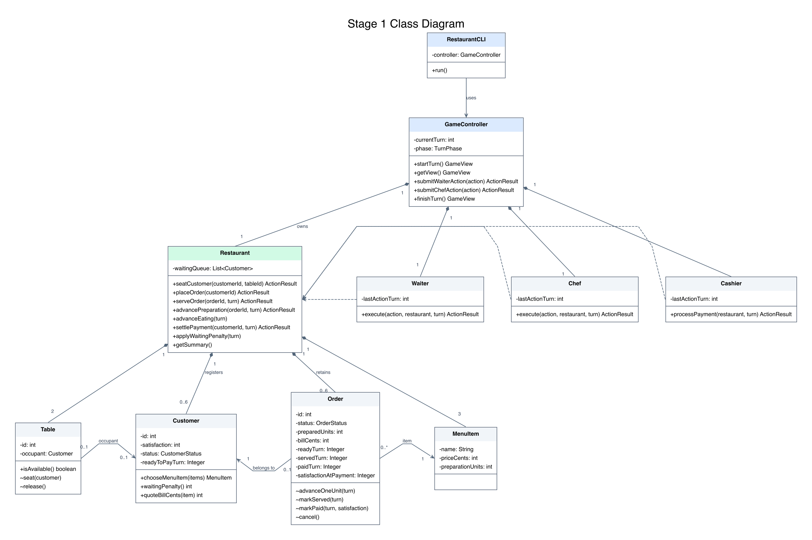

# Stage 1 Design Materials

## Integrated Stage 1 and E handoff

- [E acceptance handoff](Stage_1_E_Handoff.md): test commands, expected outputs,
  manual acceptance matrix, evidence format and the stage-1 release gate.
- [Member A implementation and integration](Member_A_Integration.md): ownership,
  implemented C/D wiring, CLI call sequence, state boundaries and replay table.
- [Project README](../README.md): build, play, developer checks and replay commands.
- [Replay inputs](../test/replays/README.md): real Main/CLI stdin fixtures.

Run `bash scripts/run.sh` to play or `bash scripts/test-stage1.sh` for A's development
checks. The latter runs 14 core scenarios and 344 assertions with the production
Order plus 5 production smoke scenarios and 62 assertions. Independent E
acceptance is pending; no stage-1 release tag is created by these scripts.

## Earlier design proposal

English design proposal for team discussion before implementation.

- [PDF design document](Stage_1_Design_Discussion_EN.pdf) - includes class responsibilities, relationships, interface contracts, states, turn rules, acceptance scenarios, and the UML diagram.
- [Editable English text](Stage_1_Design_Discussion_EN.md).
- [UML files and editing instructions](UML/README.md).

The architecture and method contracts are proposed team decisions. Acceptance scenarios are manually derived specifications pending implementation and execution.

